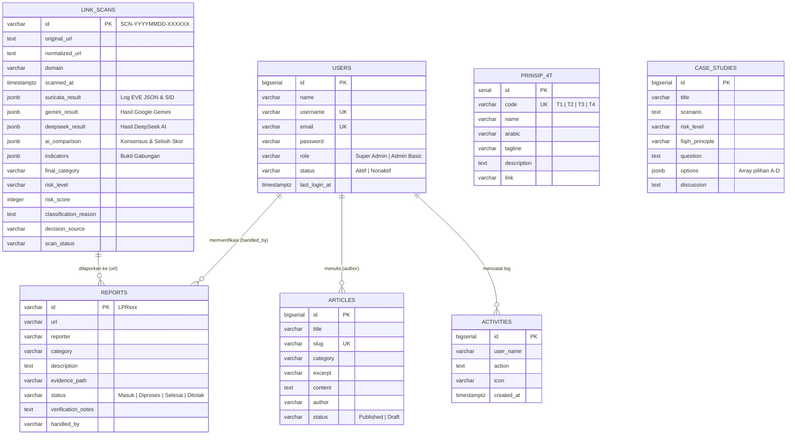

# 🗄️ Catatan & Kontrak Lengkap Database (Supabase PostgreSQL)
## Aswaja CyberShield — Dokumentasi Skema Tabel, JSONB & Migrasi

Dokumen ini merupakan **satu-satunya rujukan terpadu untuk Database** pada platform **Aswaja CyberShield**, mencakup informasi database Supabase PostgreSQL, spesifikasi lengkap 8 tabel utama, struktur payload JSONB audit forensik (`link_scans`), serta konfigurasi koneksi Laravel.

---

## 📌 1. Informasi & Identitas Database Proyek

- **Nama Database Proyek (PostgreSQL Mandiri / Local / VPS):** **`aswaja_cybershield`**
- **Nama Database Bawaan Supabase Cloud:** **`postgres`**
- **Nama Project di Dashboard Supabase:** **`aswaja-cybershield`**
- **Lokasi Migrasi Laravel:** [`backend/database/migrations/`](file:///d:/aswajaCyber/backend/database/migrations)
- **Model Eloquent Audit Tautan:** [`backend/app/Models/LinkScan.php`](file:///d:/aswajaCyber/backend/app/Models/LinkScan.php)
- **Adapter Fallback Tanpa DB:** [`backend/app/Repositories/MockDataRepository.php`](file:///d:/aswajaCyber/backend/app/Repositories/MockDataRepository.php) & [`backend/app/Services/ScanHistoryService.php`](file:///d:/aswajaCyber/backend/app/Services/ScanHistoryService.php)

> 💡 **Arsitektur Dual-Mode (Database & In-Memory Fallback):**  
> Sistem dirancang agar dapat langsung berjalan mulus menggunakan `MockDataRepository` dan penyimpanan sesi sebelum database PostgreSQL dihubungkan. Begitu kredensial Supabase dimasukkan ke `backend/.env`, sistem otomatis menyimpan data ke PostgreSQL tanpa perlu mengubah kode di Controller maupun Frontend.

---

## 🏗️ 2. Diagram Relasi & Struktur Tabel (ERD)



---

## 📋 3. Spesifikasi Lengkap 8 Skema Tabel SQL (PostgreSQL)

### A. Tabel `link_scans` (Riwayat Audit Pemeriksaan Tautan Suricata & Dual AI)
 Setiap pemeriksaan tautan di halaman **AI Tabayyun** wajib disimpan dengan memisahkan hasil **Suricata NIDS**, **Google Gemini**, dan **DeepSeek AI** ke dalam kolom JSONB tersendiri untuk keperluan audit forensik.

```sql
CREATE TABLE link_scans (
    id VARCHAR(64) PRIMARY KEY,                  -- ID unik audit (Format: SCN-YYYYMMDD-XXXXXX)
    original_url TEXT NOT NULL,                  -- Tautan mentah yang dimasukkan pengguna
    normalized_url TEXT NOT NULL,                -- Tautan hasil sanitasi dan normalisasi
    domain VARCHAR(255) NOT NULL,                -- Domain/hostname utama target
    scanned_at TIMESTAMP WITH TIME ZONE NOT NULL,-- Waktu pelaksanaan audit

    -- Penyimpanan Independen Per-Engine (JSONB Terpisah untuk Kebutuhan Audit)
    suricata_result JSONB NULL,                  -- Log sensor jaringan: {status, available, matched, alerts, indicators}
    gemini_result JSONB NULL,                    -- Analisis Gemini: {status, category, risk_level, risk_score, indicators, reasoning, confidence}
    deepseek_result JSONB NULL,                  -- Analisis DeepSeek: {status, category, risk_level, risk_score, indicators, reasoning, confidence}

    -- Hasil Evaluasi AI Comparison & Matriks Korelasi Keputusan
    ai_comparison JSONB NULL,                    -- Status komparasi: {both_available, is_match, agreed_category, score_delta, has_discrepancy}
    indicators JSONB NOT NULL,                   -- Array gabungan seluruh bukti indikator (URL + Suricata + Dual AI)
    final_category VARCHAR(50) NOT NULL CHECK (
        final_category IN ('normal', 'mencurigakan', 'terindikasi_judol', 'terindikasi_investasi', 'belum_dapat_disimpulkan')
    ),
    risk_level VARCHAR(20) NOT NULL CHECK (
        risk_level IN ('rendah', 'sedang', 'tinggi', 'kritis')
    ),
    risk_score INTEGER NOT NULL CHECK (
        risk_score >= 0 AND risk_score <= 100
    ),
    classification_reason TEXT NOT NULL,         -- Narasi komprehensif dasar penentuan vonis
    decision_source VARCHAR(50) NOT NULL,        -- parallel_dual_ai | suricata_ids | dual_ai_only | suricata_whitelist | unconfigured
    scan_status VARCHAR(30) DEFAULT 'completed' CHECK (
        scan_status IN ('completed', 'partial', 'failed', 'unconfigured')
    ),

    created_at TIMESTAMP WITH TIME ZONE DEFAULT NOW(),
    updated_at TIMESTAMP WITH TIME ZONE DEFAULT NOW()
);

CREATE INDEX idx_link_scans_domain ON link_scans(domain);
CREATE INDEX idx_link_scans_final_category ON link_scans(final_category);
CREATE INDEX idx_link_scans_risk_level ON link_scans(risk_level);
CREATE INDEX idx_link_scans_scanned_at ON link_scans(scanned_at DESC);
CREATE INDEX idx_link_scans_decision_source ON link_scans(decision_source);
```

#### Struktur JSONB pada Tabel `link_scans`:
1. **`suricata_result`**:
   ```json
   {
     "status": "tersedia",
     "available": true,
     "matched": true,
     "alerts_count": 1,
     "alerts": [
       {
         "timestamp": "2026-11-04T08:30:00+08:00",
         "signature_id": 1000001,
         "alert_signature": "ASWAJA-IDS [TINGKAT KUAT]: Indikator Kuat Judi Online",
         "severity": 1,
         "proto": "UDP",
         "src_ip": "192.168.1.110",
         "dest_ip": "8.8.8.8"
       }
     ]
   }
   ```
2. **`gemini_result` & `deepseek_result`**:
   ```json
   {
     "provider": "gemini",
     "model": "gemini-1.5-flash",
     "status": "connected",
     "category": "judol",
     "risk_level": "critical",
     "risk_score": 92,
     "indicators": [
       {
         "name": "keyword_detection",
         "evidence": "slot gacor 777",
         "severity": "critical",
         "explanation": "Pola promosi mesin slot perjudian daring"
       }
     ],
     "reasoning": "Ditemukan bukti kuat penawaran judi daring.",
     "confidence": 0.95
   }
   ```

---

### B. Tabel `users` (Akun Administrator & Staf Analis)
```sql
CREATE TABLE users (
    id BIGSERIAL PRIMARY KEY,
    name VARCHAR(255) NOT NULL,
    username VARCHAR(100) UNIQUE NOT NULL,
    email VARCHAR(255) UNIQUE NOT NULL,
    password VARCHAR(255) NOT NULL,
    role VARCHAR(50) DEFAULT 'Admin Basic' CHECK (role IN ('Super Admin', 'Admin Basic')),
    status VARCHAR(50) DEFAULT 'Aktif' CHECK (status IN ('Aktif', 'Nonaktif')),
    last_login_at TIMESTAMP WITH TIME ZONE NULL,
    created_at TIMESTAMP WITH TIME ZONE DEFAULT NOW(),
    updated_at TIMESTAMP WITH TIME ZONE DEFAULT NOW()
);

CREATE INDEX idx_users_username ON users(username);
CREATE INDEX idx_users_email ON users(email);
```

---

### C. Tabel `reports` (Laporan Aduan Siber Warga)
```sql
CREATE TABLE reports (
    id VARCHAR(50) PRIMARY KEY, -- Format tiket: LPR081, LPR082, dst.
    url VARCHAR(2048) NOT NULL,
    reporter VARCHAR(150) DEFAULT 'Hamba Allah',
    category VARCHAR(255) NOT NULL,
    description TEXT NOT NULL,
    evidence_path VARCHAR(1024) NULL,
    status VARCHAR(50) DEFAULT 'Masuk' CHECK (status IN ('Masuk', 'Pending', 'Diproses', 'Selesai', 'Ditolak')),
    verification_notes TEXT NULL,
    handled_by VARCHAR(150) DEFAULT 'Belum Ditugaskan',
    created_at TIMESTAMP WITH TIME ZONE DEFAULT NOW(),
    updated_at TIMESTAMP WITH TIME ZONE DEFAULT NOW()
);

CREATE INDEX idx_reports_status ON reports(status);
CREATE INDEX idx_reports_created_at ON reports(created_at DESC);
```

---

### D. Tabel `articles` (Artikel Edukasi Fiqih Siber)
```sql
CREATE TABLE articles (
    id BIGSERIAL PRIMARY KEY,
    title VARCHAR(255) NOT NULL,
    slug VARCHAR(255) UNIQUE NOT NULL,
    category VARCHAR(100) NOT NULL,
    excerpt VARCHAR(500) NULL,
    content TEXT NOT NULL,
    author VARCHAR(150) DEFAULT 'Tim Edukasi Aswaja',
    read_time VARCHAR(50) DEFAULT '5 Menit Baca',
    status VARCHAR(50) DEFAULT 'Published' CHECK (status IN ('Published', 'Draft')),
    cover_image VARCHAR(1024) NULL,
    created_at TIMESTAMP WITH TIME ZONE DEFAULT NOW(),
    updated_at TIMESTAMP WITH TIME ZONE DEFAULT NOW()
);

CREATE INDEX idx_articles_slug ON articles(slug);
CREATE INDEX idx_articles_status ON articles(status);
```

---

### E. Tabel `case_studies` (Studi Kasus & Soal Kuis Cyber Guard)
```sql
CREATE TABLE case_studies (
    id BIGSERIAL PRIMARY KEY,
    title VARCHAR(255) NOT NULL,
    scenario TEXT NOT NULL,
    sender VARCHAR(150) NULL,
    message TEXT NULL,
    risk_level VARCHAR(50) DEFAULT 'Sedang' CHECK (risk_level IN ('Kritis', 'Tinggi', 'Sedang')),
    fiqih_principle VARCHAR(150) NOT NULL,
    question TEXT NOT NULL,
    options JSONB NOT NULL, -- Format: [{"key":"A","text":"...","correct":false},{"key":"B","text":"...","correct":true}]
    discussion TEXT NOT NULL,
    created_at TIMESTAMP WITH TIME ZONE DEFAULT NOW(),
    updated_at TIMESTAMP WITH TIME ZONE DEFAULT NOW()
);

CREATE INDEX idx_case_studies_risk ON case_studies(risk_level);
```

---

### F. Tabel `prinsip_4t` (Materi Kaidah Fiqih Siber Dinamis)
```sql
CREATE TABLE prinsip_4t (
    id SERIAL PRIMARY KEY,
    code VARCHAR(10) UNIQUE NOT NULL, -- T1, T2, T3, T4
    name VARCHAR(100) NOT NULL,        -- Tawaqquf, Tastabbus, Tatsabbut, Ta'aqqul
    arabic VARCHAR(100) NOT NULL,
    tagline VARCHAR(255) NOT NULL,
    description TEXT NOT NULL,
    link VARCHAR(255) NOT NULL,
    icon VARCHAR(100) DEFAULT 'verified_user',
    created_at TIMESTAMP WITH TIME ZONE DEFAULT NOW(),
    updated_at TIMESTAMP WITH TIME ZONE DEFAULT NOW()
);
```

---

### G. Tabel `activities` (Log Aktivitas Admin) & `personal_access_tokens` (Sanctum)
```sql
CREATE TABLE activities (
    id BIGSERIAL PRIMARY KEY,
    user_name VARCHAR(150) NOT NULL,
    action TEXT NOT NULL,
    icon VARCHAR(100) DEFAULT 'arrow-repeat',
    created_at TIMESTAMP WITH TIME ZONE DEFAULT NOW()
);

CREATE TABLE personal_access_tokens (
    id BIGSERIAL PRIMARY KEY,
    tokenable_type VARCHAR(255) NOT NULL,
    tokenable_id BIGINT NOT NULL,
    name VARCHAR(255) NOT NULL,
    token VARCHAR(64) UNIQUE NOT NULL,
    abilities TEXT NULL,
    last_used_at TIMESTAMP WITH TIME ZONE NULL,
    expires_at TIMESTAMP WITH TIME ZONE NULL,
    created_at TIMESTAMP WITH TIME ZONE DEFAULT NOW(),
    updated_at TIMESTAMP WITH TIME ZONE DEFAULT NOW()
);
```

---

## ⚙️ 4. Konfigurasi Koneksi `.env` Database Supabase

Masukkan konfigurasi berikut pada berkas `backend/.env` saat menghubungkan ke Supabase PostgreSQL:

```env
DB_CONNECTION=pgsql
DB_HOST=db.xxxxxxxxxxxx.supabase.co
DB_PORT=5432
DB_DATABASE=postgres            # Gunakan 'postgres' untuk Supabase Cloud, atau 'aswaja_cybershield' untuk lokal/VPS
DB_USERNAME=postgres
DB_PASSWORD=your_supabase_password_here
DB_SSLMODE=require
```

