# 🗄️ Catatan & Kontrak Lengkap Database (Supabase PostgreSQL)
## Aswaja CyberShield — Dokumentasi Skema Tabel, JSONB & Migrasi

Dokumen ini merupakan **satu-satunya rujukan terpadu untuk Database** pada platform **Aswaja CyberShield**, mencakup informasi database Supabase PostgreSQL, spesifikasi lengkap 8 tabel utama, struktur payload JSONB audit forensik (`link_scans`), serta konfigurasi koneksi Laravel dan sinkronisasi live data.

---

## 📌 1. Informasi & Identitas Database Proyek

- **Nama Database Bawaan Supabase Cloud:** **`postgres`**
- **Nama Project di Dashboard Supabase:** **`aswaja_cyber_shield`** (Project ID: `tffadqzdhltroeuuckjw`, Region: `ap-southeast-1`)
- **Host Koneksi Pooler IPv4:**`aws-0-ap-southeast-1.pooler.supabase.com`** (Port: `587`)
- **Skrip Master SQL Supabase / PostgreSQL:** [`aswajacyber.sql`](file:///d:/cybershield/aswajacyber.sql)
- **Lokasi Migrasi Laravel:** [`backend/database/migrations/`](file:///d:/cybershield/backend/database/migrations/)
- **Model-Model Eloquent:**
  - [`backend/app/Models/User.php`](file:///d:/cybershield/backend/app/Models/User.php)
  - [`backend/app/Models/LinkScan.php`](file:///d:/cybershield/backend/app/Models/LinkScan.php)
  - [`backend/app/Models/Report.php`](file:///d:/cybershield/backend/app/Models/Report.php)
  - [`backend/app/Models/Article.php`](file:///d:/cybershield/backend/app/Models/Article.php)
  - [`backend/app/Models/CaseStudy.php`](file:///d:/cybershield/backend/app/Models/CaseStudy.php)
  - [`backend/app/Models/Prinsip4T.php`](file:///d:/cybershield/backend/app/Models/Prinsip4T.php)
  - [`backend/app/Models/Activity.php`](file:///d:/cybershield/backend/app/Models/Activity.php)
- **Database Seeder Otomatis:** [`backend/database/seeders/DatabaseSeeder.php`](file:///d:/cybershield/backend/database/seeders/DatabaseSeeder.php)
- **Repository Database-First:** [`backend/app/Repositories/MockDataRepository.php`](file:///d:/cybershield/backend/app/Repositories/MockDataRepository.php)
- **Versi Runtime:** PHP 8.5.12 (ZTS Visual C++ 2022 x64 dengan ekstensi `pdo_pgsql`, `pgsql`, `pdo_sqlite`, `openssl`, `mbstring`, `curl`).

> **Arsitektur Database-First & Live Data Sync:**  
> Sistem beroperasi dengan prioritas **Database-First** langsung ke Supabase PostgreSQL. Semua pembaruan data pengguna admin, laporan aduan masyarakat, studi kasus kuis, dan materi edukasi langsung tersinkronisasi mulus secara live antara antarmuka publik dan panel admin. Jika koneksi jaringan database sedang terputus, sistem secara cerdas beralih ke cache fallback tanpa pernah menimbulkan *fatal crash*.

---

## 2. Diagram Relasi & Struktur Tabel (ERD)

```mermaid
erDiagram
    USERS {
        bigserial id PK
        varchar name
        varchar username UK
        varchar email UK
        varchar password
        varchar role "Super Admin | Admin Basic"
        varchar status "Aktif | Nonaktif"
        timestamptz last_login_at
    }

    LINK_SCANS {
        varchar id PK "SCN-YYYYMMDD-XXXXXX"
        text original_url
        text normalized_url
        varchar domain
        timestamptz scanned_at
        jsonb suricata_result "Log EVE JSON & SID"
        jsonb gemini_result "Hasil Google Gemini"
        jsonb ai_comparison "Evaluasi & Status Konsistensi AI"
        jsonb indicators "Bukti Gabungan (URL + Suricata + Gemini)"
        jsonb techniques "Teknik Judol: Defacement, Open Redirect, Typosquatting"
        varchar final_category
        varchar risk_level
        integer risk_score
        text classification_reason
        varchar decision_source
        varchar scan_status
    }

    REPORTS {
        varchar id PK "LPRxxx"
        varchar url
        varchar reporter
        varchar category
        text description
        varchar evidence_path
        varchar status "Masuk | Diproses | Selesai | Ditolak"
        text verification_notes
        varchar handled_by
        jsonb ai_analysis
    }

    ARTICLES {
        bigserial id PK
        varchar title
        varchar slug UK
        varchar category
        varchar excerpt
        text content
        varchar author
        varchar status "Published | Draft"
    }

    PRINSIP_4T {
        serial id PK
        varchar code UK "T1 | T2 | T3 | T4"
        varchar name
        varchar arabic
        varchar tagline
        text description
        varchar link
    }

    CASE_STUDIES {
        bigserial id PK
        varchar title
        text scenario
        varchar sender
        text message
        varchar risk_level "Kritis | Tinggi | Sedang"
        varchar fiqih_principle
        text question
        jsonb options "Format Pilihan Ganda A-D"
        text discussion
    }

    ACTIVITIES {
        bigserial id PK
        varchar user_name
        text action
        varchar icon
        varchar badge_class
        timestamptz created_at
    }

    PERSONAL_ACCESS_TOKENS {
        bigserial id PK
        varchar tokenable_type
        bigint tokenable_id
        varchar name
        varchar token UK
        text abilities
        timestamptz last_used_at
        timestamptz expires_at
    }
```



> **Efisiensi Skema:**  
> Seluruh tabel pada Supabase PostgreSQL, berkas master SQL [`aswajacyber.sql`](file:///d:/cybershield/aswajacyber.sql), migration Laravel, model [`LinkScan.php`](file:///d:/cybershield/backend/app/Models/LinkScan.php), dan service [`ScanHistoryService.php`](file:///d:/cybershield/backend/app/Services/ScanHistoryService.php) telah bersih dan teroptimasi secara efisien.

---

## 3. Spesifikasi 8 Tabel Utama & DDL SQL

### A. Tabel `users` (Pengguna & Administrator)
```sql
CREATE TABLE public.users (
    id BIGSERIAL PRIMARY KEY,
    name VARCHAR(255) NOT NULL,
    username VARCHAR(100) UNIQUE NOT NULL,
    email VARCHAR(255) UNIQUE NOT NULL,
    password VARCHAR(255) NOT NULL,
    role VARCHAR(50) DEFAULT 'Admin Basic' CHECK (role IN ('Super Admin', 'Admin Basic')),
    status VARCHAR(50) DEFAULT 'Aktif' CHECK (status IN ('Aktif', 'Nonaktif')),
    last_login_at TIMESTAMP WITH TIME ZONE NULL,
    remember_token VARCHAR(100) NULL,
    created_at TIMESTAMP WITH TIME ZONE DEFAULT NOW(),
    updated_at TIMESTAMP WITH TIME ZONE DEFAULT NOW()
);
```

### B. Tabel `link_scans` (Riwayat Audit Forensik Tautan)
```sql
CREATE TABLE public.link_scans (
    id VARCHAR(64) PRIMARY KEY,                  -- SCN-YYYYMMDD-XXXXXX
    original_url TEXT NOT NULL,
    normalized_url TEXT NOT NULL,
    domain VARCHAR(255) NOT NULL,
    scanned_at TIMESTAMP WITH TIME ZONE NOT NULL,
    suricata_result JSONB NULL,                  -- Log NIDS: SID, Alert, Match
    gemini_result JSONB NULL,                    -- Analisis Google Gemini AI
    ai_comparison JSONB NULL,                    -- Status verifikasi & konsistensi AI
    indicators JSONB NOT NULL,                   -- Array gabungan bukti indikator
    techniques JSONB NULL,                       -- Array teknik judol terdeteksi
    final_category VARCHAR(50) NOT NULL CHECK (
        final_category IN ('normal', 'mencurigakan', 'terindikasi_judol', 'terindikasi_investasi', 'belum_dapat_disimpulkan')
    ),
    risk_level VARCHAR(20) NOT NULL CHECK (
        risk_level IN ('rendah', 'sedang', 'tinggi', 'kritis')
    ),
    risk_score INTEGER NOT NULL CHECK (
        risk_score >= 0 AND risk_score <= 100
    ),
    classification_reason TEXT NOT NULL,
    decision_source VARCHAR(50) NOT NULL,
    scan_status VARCHAR(50) DEFAULT 'completed',
    created_at TIMESTAMP WITH TIME ZONE DEFAULT NOW(),
    updated_at TIMESTAMP WITH TIME ZONE DEFAULT NOW()
);
```

### C. Tabel `reports` (Laporan Aduan Publik & Admin)
```sql
CREATE TABLE public.reports (
    id VARCHAR(50) PRIMARY KEY,                  -- LPRxxx
    url VARCHAR(2048) NOT NULL,
    reporter VARCHAR(150) DEFAULT 'Anonim',
    category VARCHAR(150) NOT NULL,
    description TEXT NULL,
    evidence_path VARCHAR(2048) NULL,
    status VARCHAR(50) DEFAULT 'Masuk' CHECK (status IN ('Masuk', 'Diproses', 'Selesai', 'Ditolak')),
    verification_notes TEXT NULL,
    handled_by VARCHAR(150) DEFAULT 'Belum Ditugaskan',
    ai_analysis JSONB NULL,
    created_at TIMESTAMP WITH TIME ZONE DEFAULT NOW(),
    updated_at TIMESTAMP WITH TIME ZONE DEFAULT NOW()
);
```

### D. Tabel `articles` (Artikel Edukasi Literasi & Fiqih Siber)
```sql
CREATE TABLE public.articles (
    id BIGSERIAL PRIMARY KEY,
    title VARCHAR(255) NOT NULL,
    slug VARCHAR(255) UNIQUE NOT NULL,
    category VARCHAR(100) NOT NULL,
    excerpt VARCHAR(500) NULL,
    content TEXT NOT NULL,
    author VARCHAR(150) DEFAULT 'Tim Edukasi Aswaja',
    read_time VARCHAR(50) DEFAULT '5 Menit Baca',
    status VARCHAR(50) DEFAULT 'Published' CHECK (status IN ('Published', 'Draft')),
    cover_image VARCHAR(1024) NULL,
    created_at TIMESTAMP WITH TIME ZONE DEFAULT NOW(),
    updated_at TIMESTAMP WITH TIME ZONE DEFAULT NOW()
);
```

### E. Tabel `case_studies` (Studi Kasus & Soal Evaluasi Cyber Guard)
```sql
CREATE TABLE public.case_studies (
    id BIGSERIAL PRIMARY KEY,
    title VARCHAR(255) NOT NULL,
    scenario TEXT NOT NULL,
    sender VARCHAR(150) NULL,
    message TEXT NULL,
    risk_level VARCHAR(50) DEFAULT 'Sedang' CHECK (risk_level IN ('Kritis', 'Tinggi', 'Sedang', 'Rendah')),
    fiqih_principle VARCHAR(150) NOT NULL,
    question TEXT NOT NULL,
    options JSONB NOT NULL,                      -- Format: [{"key":"A","text":"...","correct":false}]
    discussion TEXT NOT NULL,
    created_at TIMESTAMP WITH TIME ZONE DEFAULT NOW(),
    updated_at TIMESTAMP WITH TIME ZONE DEFAULT NOW()
);
```

### F. Tabel `prinsip_4t` (Pilar Metodologi Fiqih Siber Aswaja)
```sql
CREATE TABLE public.prinsip_4t (
    id SERIAL PRIMARY KEY,
    code VARCHAR(10) UNIQUE NOT NULL,            -- T1, T2, T3, T4
    name VARCHAR(100) NOT NULL,                  -- Tawaqquf, Tastabbus, Tatsabbut, Ta'aqqul
    arabic VARCHAR(100) NOT NULL,
    tagline VARCHAR(255) NOT NULL,
    description TEXT NOT NULL,
    link VARCHAR(255) NOT NULL,
    icon VARCHAR(100) DEFAULT 'verified_user',
    created_at TIMESTAMP WITH TIME ZONE DEFAULT NOW(),
    updated_at TIMESTAMP WITH TIME ZONE DEFAULT NOW()
);
```

### G. Tabel `activities` (Log Aktivitas Admin) & `personal_access_tokens` (Sanctum)
```sql
CREATE TABLE public.activities (
    id BIGSERIAL PRIMARY KEY,
    user_name VARCHAR(150) NOT NULL,
    action TEXT NOT NULL,
    icon VARCHAR(100) DEFAULT 'arrow-repeat',
    badge_class VARCHAR(100) NULL,
    created_at TIMESTAMP WITH TIME ZONE DEFAULT NOW()
);

CREATE TABLE public.personal_access_tokens (
    id BIGSERIAL PRIMARY KEY,
    tokenable_type VARCHAR(255) NOT NULL,
    tokenable_id BIGINT NOT NULL,
    name VARCHAR(255) NOT NULL,
    token VARCHAR(64) UNIQUE NOT NULL,
    abilities TEXT NULL,
    last_used_at TIMESTAMP WITH TIME ZONE NULL,
    expires_at TIMESTAMP WITH TIME ZONE NULL,
    created_at TIMESTAMP WITH TIME ZONE DEFAULT NOW(),
    updated_at TIMESTAMP WITH TIME ZONE DEFAULT NOW()
);
```

---

## 4. Konfigurasi Koneksi `.env` Supabase (IPv4 Pooler)

Karena host direct Supabase (`db.<ref>.supabase.co`) hanya meresolusi alamat IPv6, pada jaringan internet di Indonesia yang belum mendukung rute IPv6 penuh, koneksi diarahkan menggunakan **Supabase Session Pooler IPv4**:

```env
DB_CONNECTION=pgsql
DB_HOST=aws-0-ap-southeast-1.pooler.supabase.com
DB_PORT=5432
DB_DATABASE=postgres
DB_USERNAME=postgres.[PROJECT_REF]
DB_PASSWORD=[YOUR_SUPABASE_PASSWORD]
DB_SSLMODE=require
```

### Perintah Uji Koneksi Database:
```powershell
php backend/test_db_connection.php
```

Output terverifikasi:
```text
KONEKSI BERHASIL TERSAMBUNG KE SUPABASE!
Informasi Server: PostgreSQL 17.11 on aarch64-unknown-linux-gnu
Jumlah Tabel di Skema Public: 9 tabel (migrations, users, link_scans, reports, articles, case_studies, prinsip_4t, activities, personal_access_tokens).
```

---

## 5. Sinkronisasi Data Live: Publik vs Panel Admin

Platform menerapkan asas transparansi dan integritas data penuh:
1. **Laporan Publik (`frontend/lapor.blade.php`):** Mengambil data rekapitulasi pelaporan publik dari endpoint `GET /api/reports` yang terhubung langsung ke tabel `reports` Supabase.
2. **Riwayat Admin (`frontend/admin/laporan.blade.php`):** Mengambil data yang sama dengan wewenang memperbarui status atau menghapus laporan (khusus Super Admin).
3. **Pembaruan Seketika:** Ketika admin mengubah status laporan di dashboard admin dari *"Diproses"* menjadi *"Selesai"*, pembaruan langsung tersimpan di Supabase dan langsung tampil pada tabel rekapitulasi publik saat dimuat.
4. **Studi Kasus (`frontend/cyber-guard.blade.php`):** Mengambil 4 skenario simulasi langsung dari tabel `case_studies` yang dikelola secara live lewat `/admin/studi-kasus`.
5. **Akun Pengguna (`frontend/admin/akun.blade.php`):** Mengambil data staf admin langsung dari tabel `users` Supabase (Admin Utama, Muhammad Ali Reza, Deby Cantika Putri). Seluruh akun langsung aktif tanpa mewajibkan verifikasi email (`email_verified_at` telah resmi di-drop / ditiadakan dari skema aktif: `ALTER TABLE users DROP COLUMN IF EXISTS email_verified_at;`).
6. **Kaidah Prinsip 4T (`frontend/etika.blade.php` & `frontend/admin/artikel.blade.php`):** Tersinkronisasi dua arah dari tabel `prinsip_4t`. Sistem mendukung pembaruan menggunakan kode string unik (`T1`, `T2`, `T3`, `T4`) maupun primary key integer `id`.

---

## 6. Fungsi Strategis Penyimpanan Data Tautan (`link_scans` & `reports`)

Penyimpanan riwayat pemeriksaan tautan ke dalam basis data PostgreSQL Supabase (tabel `link_scans` dan `reports`) memiliki **5 fungsi utama**:

1. **Mesin Pembelajaran Mandiri (*Self-Learning Threat Intelligence*):**
   - **Belajar dari Laporan Masyarakat (`reports`):** Tautan dan nomor rekening sindikat yang dilaporkan warga ke `/lapor` tersimpan permanen. Saat tautan atau domain tersebut diuji oleh pengguna lain di `/tabayyun`, sistem langsung menampilkan indikator:
     > *"Pembelajaran Basis Data Aduan: Tautan/domain telah tercatat dalam basis data laporan masyarakat (Tiket #LPRxxx) sebagai situs berbahaya."*
   - **Belajar dari Riwayat Pemindaian (`link_scans`):** Menyimpan riwayat audit pemindaian lengkap (`#SCN-YYYYMMDD-XXXXXX`). Pemindaian berulang terhadap domain yang sama langsung mendeteksi riwayat vonis terdahulu secara instan.
   - **Ekstraksi Kata Kunci Dinamis:** Mengekstrak nama merek judi online baru dari domain lama yang tersimpan untuk memperluas deteksi otomatis sindikat baru (*self-evolving intelligence*).

2. **Akuntabilitas Hukum & Jejak Forensik Siber (*Audit Trail & Non-Repudiation*):**
   - Setiap pemindaian menyimpan seluruh berkas pembuktian dalam format JSONB:
     - Log sensor telemetri jaringan Suricata NIDS (`eve.json`, nomor SID, waktu deteksi).
     - Hasil analisis kognitif semantik dan pertimbangan Google Gemini AI.
     - Rincian teknik manipulasi siber yang terbukti (*Web Defacement, Open Redirect, atau Typosquatting*).
     - Waktu pemindaian terverifikasi dalam format ISO 8601.
   - Berkas ini siap dijadikan alat bukti digital sah saat regulator (Komdigi/OJK/Bappebti/Polri) meminta log audit untuk pemblokiran (*takedown*) domain atau rekening penampung.

3. **Efisiensi Kinerja & Penghematan Kuota AI (*Performance & Resource Conservation*):**
   - Menghemat kuota token Google Gemini AI dan mengurangi latensi jaringan dengan mengenali tautan yang sudah pernah diperiksa sebelumnya (*instant cache verification*).

4. **Agregasi Metrik & Dashboard Pemantauan Admin (`/admin`):**
   - Menyediakan data statistik *real-time* bagi administrator:
     - Tren volume pemeriksaan per hari.
     - Persentase kategori ancaman (Judi Online vs Investasi Bodong vs Aman).
     - Rasio efektivitas sensor deterministik Suricata NIDS dan kecerdasan kognitif Google Gemini AI.

5. **Transparansi Sesuai Nilai Tabayyun & Ta'aqqul:**
   - Menyediakan ID audit unik (misal `#SCN-20261108-V9RKCX`) pada setiap hasil analisis yang dapat dibagikan masyarakat sebagai bukti verifikasi yang sah dan objektif.
