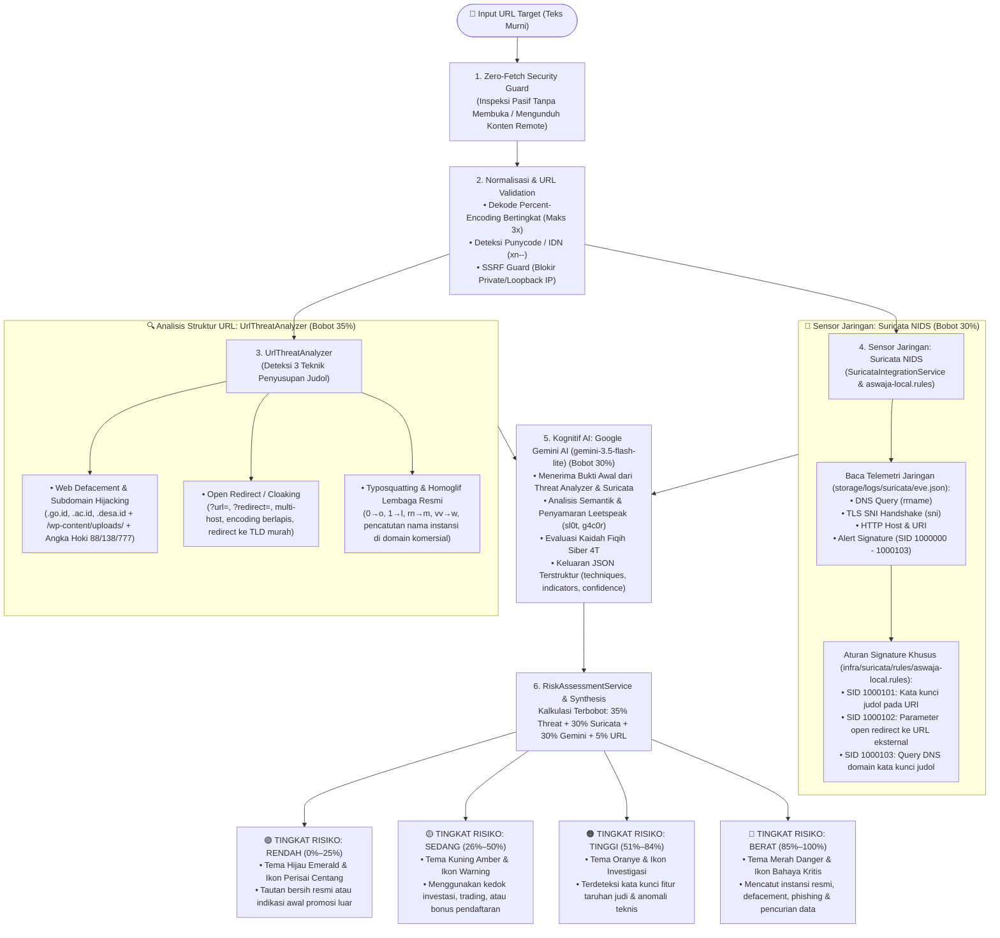

# 🛡️ Catatan Khusus: Integrasi Suricata NIDS, UrlThreatAnalyzer & Google Gemini AI
## Sistem Deteksi Tautan Judi Online (Judol) & Investasi Menyesatkan — Aswaja CyberShield

Dokumen ini disusun khusus sebagai **panduan teknis bagi Penguji dan Dewan Juri** mengenai cara kerja kolaborasi **Sensor Jaringan Suricata NIDS (`eve.json` & `suricata.rules`)**, **UrlThreatAnalyzer (Deteksi 3 Teknik Penyusupan Tautan)**, dan **Google Gemini AI (`gemini-3.5-flash-lite`)** dalam mendeteksi ancaman kejahatan siber berbasis **Judi Online (*Judol*)** dan **Investasi Menyesatkan (*Investasi Bodong*)**.

---

## 🗺️ 1. Diagram Arsitektur Multi-Layer Detection



---

## 📡 2. Suricata NIDS & Berkas Telemetri `eve.json`

### 2.1. Peran Suricata NIDS dalam Arsitektur
**Suricata** adalah mesin pendeteksi intrusi jaringan (*Network Intrusion Detection System* — NIDS) berstandar industri. Suricata bertindak sebagai **sensor deterministik garis depan** yang memeriksa paket pada level protokol jaringan:
1. **Kecepatan Mikrodetik:** Mencocokkan tanda ancaman secara instan berdasarkan nomor *Signature ID* (`SID`).
2. **Inspeksi TLS SNI:** Tetap mampu membaca domain tujuan pada sambungan HTTPS (`tls.sni` saat *ClientHello*) sebelum aliran data dienkripsi.
3. **Log EVE JSON (`eve.json`):** Berkas log telemetri standar yang diekstraksi dan diparsing oleh [`SuricataIntegrationService.php`](file:///d:/cybershield/backend/app/Services/SuricataIntegrationService.php).

### 2.2. Aturan Signature Suricata Resmi
Aturan signature disimpan di [`suricata.rules`](file:///d:/cybershield/suricata.rules) dan [`infra/suricata/rules/aswaja-local.rules`](file:///d:/cybershield/infra/suricata/rules/aswaja-local.rules):

| Nomor SID | Target & Prioritas | Deskripsi Signature |
| :--- | :--- | :--- |
| **`SID: 1000000`** | `PASS` (Priority 4) | **Whitelist Regulator:** Domain resmi `.ojk.go.id`, `.bappebti.go.id`, `.bi.go.id`, `.kominfo.go.id`. |
| **`SID: 1000001`** | `ALERT` (Priority 1) | **[Tingkat Kuat]** Frasa eksplisit judol (`slot-gacor`, `situs-togel`, `casino-online`, `slot88`, `slot777`). |
| **`SID: 1000002`** | `ALERT` (Priority 2) | **[Tingkat Menengah]** Fitur taruhan (`maxwin`, `jackpot`, `scatter`, `free-spin`, `rtp-live`). |
| **`SID: 1000003`** | `ALERT` (Priority 3) | **[Kontekstual]** Istilah mitologi (`zeus`, `dewa`, `thor`, `dragon`, `olympus`). |
| **`SID: 1000004`** | `ALERT` (Priority 1) | **Transaksi Judol:** Rute deposit kilat (`deposit-dana`, `deposit-qris`, `depo-pulsa`) & TLS SNI gacor. |
| **`SID: 1000005`** | `ALERT` (Priority 2) | **TLD Murahan:** Ekstensi domain murah/sindikat (`.vip`, `.cc`, `.xyz`, `.top`, `.fun`, `.click`, `.icu`). |
| **`SID: 1000006`** | `ALERT` (Priority 1) | **Investasi Bodong:** Janji keuntungan fiktif (`robot-trading`, `profit-pasti`, `cuan-harian`, `auto-profit`). |
| **`SID: 1000007`** | `ALERT` (Priority 3) | **Afiliasi Perekrutan:** Parameter member sindikat (`?ref=`, `?aff=`, `?agent=`, `?referral=`). |
| **`SID: 1000008`** | `ALERT` (Priority 1) | **Berkas Berbahaya:** Unduhan APK/EXE mencurigakan yang disebarkan lewat tautan. |
| **`SID: 1000101`** | `ALERT` (Priority 1) | **URI Judol Baru:** `http.uri` memuat kata kunci `/(slot\|gacor\|maxwin\|togel\|sbobet\|scatter\|rtp)/i`. |
| **`SID: 1000102`** | `ALERT` (Priority 1) | **Open Redirect:** Parameter redirect mengarah ke URL eksternal `https?://` atau URL-encoded. |
| **`SID: 1000103`** | `ALERT` (Priority 1) | **DNS Judol:** Query DNS domain yang mengandung kata kunci judol. |

### 2.3. Pengujian Sintaks & Tuning False Positive
1. **Pengujian Rule (`suricata -T`):**
   ```bash
   suricata -T -c /etc/suricata/suricata.yaml -S infra/suricata/rules/aswaja-local.rules
   ```
2. **Menyesuaikan False Positive:**
   - Parameter `return=` atau `url=` internal aplikasi sah dapat ditangani dengan mengecualikan subnet lokal (`!$HOME_NET`) atau menerapkan *thresholding* frekuensi alert pada `threshold.config`.

---

## 🔎 3. Deteksi 3 Teknik Penyusupan Tautan (`UrlThreatAnalyzer.php`)

Menanggapi evolusi kejahatan siber di mana sindikat judol tidak lagi membuat domain baru melainkan menunggangi situs bereputasi tinggi, sistem dilengkapi analis khusus ([`UrlThreatAnalyzer.php`](file:///d:/cybershield/backend/app/Services/UrlThreatAnalyzer.php)):

1. **Web Defacement & Subdomain Hijacking:**
   - Menyasar domain instansi bereputasi tinggi (`.go.id`, `.ac.id`, `.sch.id`, `.mil.id`, `.desa.id`).
   - Menyusup lewat direktori upload CMS yang rentan (`/wp-content/uploads/`, `/uploads/`, `/journal/`, `/modules/`).
   - Membuat subdomain liar yang menyematkan angka hoki judol (`88`, `138`, `777`, `vip`, dll.).

2. **Open Redirect (Pembelokan URL Otomatis):**
   - Memanfaatkan parameter redirect portal resmi untuk menyamarkan tautan judol.
   - Mendeteksi parameter manipulasi (`url`, `redirect`, `to`, `dest`, `link`, `next`, dll.).
   - Mendeteksi multi-layer percent-encoding dan target pengalihan ke TLD murah sindikat.

3. **Typosquatting & Serangan Homoglif:**
   - Meniru nama lembaga regulator/bank resmi (OJK, Bappebti, Kominfo, BI, BCA, BRI, Mandiri, dll.).
   - Mengganti huruf latin dengan angka atau karakter yang menyerupai (misal: `0` $\to$ `o`, `1` $\to$ `l/i`, `rn` $\to$ `m`, `vv` $\to$ `w`).
   - Mendaftarkan nama instansi di TLD komersial dengan embel-embel tipuan (`-resmi`, `-login`, `-bansos`, `-daftar`).

---

## 🤖 4. Integrasi Google Gemini AI (`GeminiService.php`)

Google Gemini AI bertindak sebagai mesin kognitif semantik utama:
- **Model:** `gemini-3.5-flash-lite` (latensi ultra-rendah di bawah 1 detik).
- **Prompt Injection Defense:** URL diperlakukan sebagai **data teks pasif murni**, bukan instruksi komputasi.
- **Analisis Bukti Awal:** Menerima data temuan dari `UrlThreatAnalyzer` dan `Suricata NIDS` untuk diverifikasi secara semantik.
- **Dukungan Fiqih 4T Siber:** Memverifikasi kesesuaian prinsip Tawaqquf, Tastabbus, Tatsabbut, dan Ta'aqqul dalam muatan penawaran.
- **Keluaran Terstruktur (JSON):**
  ```json
  {
    "category": "judol",
    "risk_level": "critical",
    "risk_score": 92,
    "techniques": ["web_defacement", "open_redirect"],
    "indicators": [
      {
        "name": "defacement_path",
        "evidence": "/wp-content/uploads/slot-gacor/",
        "severity": "critical",
        "explanation": "Penyusupan direktori upload CMS dengan konten judol."
      }
    ],
    "reasoning": "Ditemukan indikasi kuat penyusupan halaman slot pada domain institusi pemerintah.",
    "confidence": 0.95
  }
  ```

---

## ⚖️ 5. Standardisasi 4 Tingkat Risiko Resmi (Risk Level & Color Matrix)

Berdasarkan implementasi produksi di [`RiskAssessmentService.php`](file:///d:/cybershield/backend/app/Services/RiskAssessmentService.php) dan antarmuka [`frontend/tabayyun.blade.php`](file:///d:/cybershield/frontend/tabayyun.blade.php):

| Tingkat Risiko | Rentang Skor | Warna Token / UI | Ikon Perisai | Keterangan & Tindakan |
| :--- | :---: | :---: | :---: | :--- |
| **Rendah (Aman)** | **0% – 25%** | **Emerald Green** (`#059669`) | `verified_user` | Domain resmi/legal, bebas signature bahaya. Tautan aman diakses. |
| **Sedang** | **26% – 50%** | **Amber Yellow** (`#D97706`) | `warning` | Menggunakan kedok investasi/trading atau TLD promosi. Perlu kewaspadaan. |
| **Tinggi** | **51% – 84%** | **Orange Alert** (`#EA580C`) | `gpp_maybe` | Terdeteksi kata kunci fitur taruhan judi (maxwin, scatter) atau anomali URL. |
| **Berat (Kritis)** | **85% – 100%** | **Crimson Red** (`#DC2626`) | `gpp_bad` | Terindikasi kuat jaringan judi online, defacement web instansi, atau phishing. |

### Tampilan Kartu Hasil Analisis:
1. **Untuk Hasil Aman (0% – 25%):**
   - Menampilkan label skor **"Tingkat Keamanan"** (Skor Keamanan $75\% - 100\%$).
   - Dilengkapi 3 poin verifikasi: Audit Sanad Domain, Analisis Muatan & Pola, serta Rekomendasi Tabayyun.
2. **Untuk Hasil Berbahaya (26% – 100%):**
   - Menampilkan label skor **"Tingkat Bahaya"** (Skor Bahaya $26\% - 100\%$).
   - Menampilkan modul **"Rangkuman Sederhana"** dalam bahasa awam non-teknis.
   - Menampilkan modul **"Teknik Penyusupan yang Terdeteksi"** (*Web Defacement*, *Open Redirect*, *Typosquatting*).
   - Menampilkan rincian **"Temuan Analisis Tautan & Alasan Verifikasi"** dengan bukti teks aman (dinonaktifkan agar tidak dapat diklik).

---

## 🗄️ 6. Skema Basis Data Forensik (`link_scans`)

Pada implementasi Supabase PostgreSQL:
- **Konsistensi Riwayat Scan (*Forensic Cache*):** URL identik yang diperiksa berulang akan merujuk pada rekam jejak audit yang sudah ada untuk menjamin konsistensi vonis 100%.
- **Kolom JSONB Hasil Analisis:**
  - `suricata_result`: Menyimpan data mentah temuan sensor NIDS dan signature yang terpicu.
  - `gemini_result`: Menyimpan respon kognitif AI, alasan klasifikasi, dan skor risiko dari Google Gemini.
- **Katalog Bukti:**
  - `techniques`: Array JSONB teknik penyusupan yang teridentifikasi (`web_defacement`, `open_redirect`, `typosquatting`).
  - `indicators`: Array JSONB bukti terperinci (`name`, `evidence`, `severity`, `explanation`).
- **Keputusan Akhir:**
  - `final_category`: Kategori terstandardisasi (`terindikasi_judol`, `terindikasi_investasi`, `mencurigakan`, `normal`).
  - `risk_level`: Tingkat keparahan (`rendah`, `sedang`, `tinggi`, `berat`).
  - `risk_score`: Skor numerik $0 - 100$.
