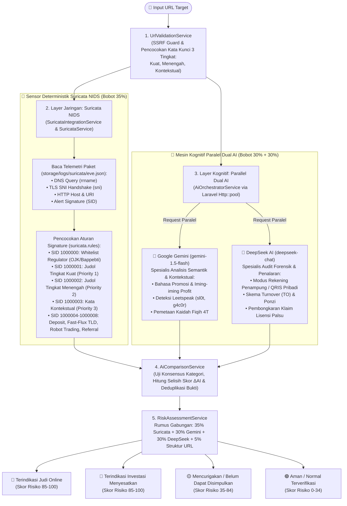

# 🛡️ Catatan Khusus: Integrasi Suricata NIDS & Parallel Dual AI (Gemini + DeepSeek)
## Sistem Deteksi Tautan Judi Online (Judol) & Investasi Menyesatkan — Aswaja CyberShield

Dokumen ini disusun khusus sebagai **panduan lengkap bagi Dewan Juri dan Penguji Teknis** mengenai cara kerja **Sensor Jaringan Suricata NIDS (`eve.json` & `suricata.rules`)** serta **Kecerdasan Buatan Ganda Paralel (Google Gemini + DeepSeek AI)** dalam mendeteksi tautan **Judi Online (*Judol*)** dan **Investasi Menyesatkan (*Investasi Bodong*)**.

---

## 🗺️ 1. Diagram Arsitektur Kolaborasi Suricata NIDS & Parallel Dual AI



---

## 📡 2. Apa Itu Suricata NIDS & Bagaimana Cara Kerjanya di Sistem Ini?

### 2.1. Pengertian Suricata NIDS
**Suricata** adalah mesin pendeteksi dan pencegah intrusi jaringan (*Network Intrusion Detection & Prevention System* — NIDS/NIPS) *open-source* berstandar internasional yang dikembangkan oleh *Open Information Security Foundation* (OISF).

Jika model AI bekerja layaknya **"Ahli Bahasa & Detektif Forensik"** yang menganalisis kalimat dan skema penipuan, maka **Suricata bekerja layaknya "Radar Sensor Lalu Lintas Jaringan"** yang memeriksa paket data di tingkat protokol jaringan (`DNS`, `TLS/HTTPS`, dan `HTTP`) menggunakan aturan pencocokan pola pasti (*Signature Rules*).

### 2.2. Mengapa Harus Menggabungkan Suricata NIDS dengan Dual AI?
1. **Kecepatan & Kepastian Hukum (Deterministik):** Suricata mencocokkan signature paket jaringan dalam hitungan mikrodetik dan memberikan nomor bukti aturan yang pasti (**SID / *Signature ID***).
2. **Mendeteksi Trafik Terenkripsi HTTPS lewat TLS SNI:** Meskipun isi halaman web judi dienkripsi dengan HTTPS, Suricata tetap dapat membaca nama domain server pada paket jabat tangan awal (`tls.sni` pada *ClientHello*).
3. **Menutup Kelemahan Satu Sama Lain (*Defense-in-Depth*):** Suricata menangkap pola jaringan teknis yang tidak terlihat oleh AI, sedangkan Dual AI membongkar kalimat manipulasi psikologis yang belum terdaftar di dalam *database signature* Suricata.

---

### 2.3. Fungsi Berkas `eve.json` dan `suricata.rules`

- **Berkas Log Telemetri Jaringan:** [`backend/storage/logs/suricata/eve.json`](file:///d:/aswajaCyber/backend/storage/logs/suricata/eve.json)
- **Berkas Aturan Signature Resmi:** [`suricata.rules`](file:///d:/aswajaCyber/suricata.rules)
- **Modul Pembaca di Laravel:** [`SuricataIntegrationService.php`](file:///d:/aswajaCyber/backend/app/Services/SuricataIntegrationService.php) & [`SuricataService.php`](file:///d:/aswajaCyber/backend/app/Services/SuricataService.php)

**Apa Fungsi [`eve.json`](file:///d:/aswajaCyber/backend/storage/logs/suricata/eve.json)?**  
**EVE (*Extensible Event Format*)** adalah format log JSON standar keluaran Suricata yang berfungsi sebagai:
1. **Perekam Bukti Paket Jaringan:** Mencatat 4 jenis *event* (`dns`, `tls`, `http`, dan `alert`) lengkap dengan alamat IP pengirim (`src_ip`), IP tujuan (`dest_ip`), protokol (`TCP`/`UDP`), nama domain (`rrname` / `sni`), serta nomor `signature_id` (`SID`).
2. **Jembatan Data ke Backend Laravel:** Dibaca oleh [`SuricataIntegrationService.php`](file:///d:/aswajaCyber/backend/app/Services/SuricataIntegrationService.php#L78-L173) (mendukung format JSON Array `[...]` yang valid di IDE maupun JSON Lines bawaan Linux) untuk mengecek apakah domain yang sedang diperiksa pernah memicu peringatan bahaya di jaringan.
3. **Penyuplai Bobot Terbesar ($35\%$):** Menjadi komponen bobot tertinggi dalam rumus penilaian risiko akhir.

**Daftar 9 Signature Rules Resmi di [`suricata.rules`](file:///d:/aswajaCyber/suricata.rules):**

| Nomor SID | Action & Prioritas | Target Inspeksi | Deskripsi Aturan Signature |
| :--- | :--- | :--- | :--- |
| **`SID: 1000000`** | `PASS` (Priority 4) | `http` / Domain | **Whitelist Resmi:** Domain lembaga negara/regulator (`.ojk.go.id`, `.bappebti.go.id`, `.bi.go.id`, `.kominfo.go.id`). |
| **`SID: 1000001`** | `ALERT` (Priority 1) | `dns.query` / URI | **[Tingkat Kuat]** Frasa eksplisit Judi Online (`slot-gacor`, `situs-togel`, `casino-online`, `bandar-togel`, `slot88`, `slot777`). |
| **`SID: 1000002`** | `ALERT` (Priority 2) | `http.uri` | **[Tingkat Menengah]** Istilah fitur taruhan (`maxwin`, `jackpot`, `scatter`, `free-spin`, `rtp-live`, `pragmatic`, `pgsoft`). |
| **`SID: 1000003`** | `ALERT` (Priority 3) | `http.uri` | **[Tingkat Kontekstual]** Kata tema/mitologi (`zeus`, `dewa`, `thor`, `dragon`, `olympus`) — hanya aktif jika ada bukti pendukung. |
| **`SID: 1000004`** | `ALERT` (Priority 1) | `tls.sni` / URI | **Transaksi & TLS Judol:** Handshake TLS SNI `gacor` & rute deposit cepat (`deposit-dana`, `deposit-qris`, `depo-pulsa`, `depo-10k`). |
| **`SID: 1000005`** | `ALERT` (Priority 2) | `http` / Domain | **Fast-Flux TLD:** Ekstensi domain berisiko tinggi yang kerap dipakai sindikat (`.vip`, `.cc`, `.xyz`, `.top`, `.fun`, `.click`, `.icu`). |
| **`SID: 1000006`** | `ALERT` (Priority 1) | `http.uri` | **Investasi Bodong:** Klaim keuntungan pasif tidak berizin (`robot-trading`, `profit-pasti`, `cuan-harian`, `auto-profit`). |
| **`SID: 1000007`** | `ALERT` (Priority 3) | `http.uri` | **Afiliasi Sindikat:** Parameter perekrutan anggota judi/ponzi (`?ref=`, `?aff=`, `?agent=`, `?referral=`). |
| **`SID: 1000008`** | `ALERT` (Priority 1) | `http.uri` | **Malware / Deposit Judol:** Parameter setoran saldo taruhan atau unduhan berkas berbahaya (`.apk`, `.exe`). |

---

## 🧠 3. Arsitektur Parallel Dual AI (Google Gemini + DeepSeek)

Berbeda dari sistem lama yang memanggil AI secara bergantian (*sequential failover*), [`AiOrchestratorService.php`](file:///d:/aswajaCyber/backend/app/Services/AiOrchestratorService.php#L204-L280) mengeksekusi **Google Gemini** dan **DeepSeek AI** secara **serentak (paralel)** menggunakan `Http::pool()`.

### 3.1. Pembagian Peran Spesialis Kedua Model AI

| Aspek Perbandingan | 🤖 Engine 1: Google Gemini ([`GeminiService.php`](file:///d:/aswajaCyber/backend/app/Services/GeminiService.php)) | 🔬 Engine 2: DeepSeek AI ([`DeepSeekService.php`](file:///d:/aswajaCyber/backend/app/Services/DeepSeekService.php)) |
| :--- | :--- | :--- |
| **Model Default** | `gemini-1.5-flash` | `deepseek-chat` (DeepSeek-V3 / R1) |
| **Peran Utama** | **Analis Semantik, Bahasa Persuasif & Konteks 4T** | **Auditor Forensik Teknis & Penalaran Modus Operandi** |
| **Fokus Deteksi Judi Online** | • Membaca penyamaran huruf (*leetspeak*: `sl0t`, `g4c0r`, `m4xw1n`)<br>• Mengenali bahasa promosi gamifikasi (*"bocoran pola hari ini"*, *"anti-rungkad"*)<br>• Mengenali ciri visual CTA deposit berkedip & *fake live withdrawal* | • Mengaudit alur rekening penampung pribadi & e-wallet/QRIS dinamis<br>• Membongkar jebakan syarat *Turnover (TO)* yang mengunci saldo korban<br>• Membongkar pencatutan lisensi judi asing palsu (*PAGCOR/Curacao*) |
| **Fokus Deteksi Investasi Bodong** | • Mendeteksi klaim keuntungan hiperbolis (*"profit 20% per hari"*)<br>• Mendeteksi klaim palsu *"100% aman tanpa risiko / resmi syariah"* | • Menganalisis struktur skema piramida/Ponzi (*member-get-member*)<br>• Memverifikasi ketiadaan izin regulator OJK & Bappebti |

### 3.2. Format Kontrak Output JSON Seragam
Kedua model AI diwajibkan mengembalikan struktur JSON terstandar yang divalidasi oleh [`AiAnalysisResultDTO.php`](file:///d:/aswajaCyber/backend/app/DTO/AiAnalysisResultDTO.php):
```json
{
  "category": "judol | investasi_menyesatkan | mencurigakan | normal",
  "risk_level": "low | medium | high | critical",
  "risk_score": 92,
  "indicators": [
    {
      "name": "strong_gambling_keyword",
      "evidence": "slot-gacor777.top",
      "severity": "critical",
      "explanation": "Mengandung frasa eksplisit mesin slot gacor dan angka hoki 777 pada TLD .top"
    }
  ],
  "reasoning": "Penjelasan analitis lengkap dari model AI.",
  "confidence": 0.95
}
```

---

## 🎯 4. Sistem Tiga Tingkat Pencocokan Kata Kunci (*3-Tier Keyword Matching*)

Agar sistem **tidak mudah salah mendeteksi website biasa (seperti artikel sejarah mitologi Yunani, berita umum, atau portal edukasi) sebagai situs Judi Online**, baik [`UrlValidationService.php`](file:///d:/aswajaCyber/backend/app/Services/UrlValidationService.php#L371-L441), **Suricata**, maupun **Prompt Dual AI** menerapkan **3 Tingkat Pencocokan**:

| Tingkat | Contoh Kata Kunci | Perlakuan Sistem | Status Akhir (Jika Mandiri) | Status Akhir (Dengan Indikator Pendukung) |
| :--- | :--- | :--- | :--- | :--- |
| **1. Kuat (`strong`)** | `slot gacor`, `situs togel`, `casino online`, `bandar togel` | **Indikator kuat** — Langsung memicu vonis ancaman tinggi (Suricata Priority 1) | 🔴 **`terindikasi_judol`** (`red` / Bahaya) | 🔴 **`terindikasi_judol`** (`red` / Bahaya) |
| **2. Menengah (`medium`)** | `maxwin`, `jackpot`, `scatter`, `free spin`, `rtp live` | **Perlu indikator pendukung** (TLD `.top`/`.vip`/`.xyz`, angka `777`/`88`, path `/deposit`, `?ref=`) | 🟡 **`mencurigakan`** (`amber` / Peringatan) | 🔴 **`terindikasi_judol`** (`red` / Bahaya) |
| **3. Kontekstual (`contextual`)** | `zeus`, `dewa`, `thor`, `dragon`, `olympus` | **Perlu pemeriksaan tambahan** — Tidak boleh menuduh situs umum sebagai Judol jika berdiri sendiri | 🟢 **`aman`** (`emerald` / Aman) | 🔴 **`terindikasi_judol`** (`red`) atau 🟡 **`mencurigakan`** (`amber`) |

### Contoh Kasus Uji Nyata (*Verified Test Cases*):
1. **`https://ensiklopedia-mitologi-zeus-thor.com`** *(Tingkat Kontekstual Mandiri)*  
   $\rightarrow$ Hanya memuat kata `zeus` dan `thor` pada domain `.com` tanpa indikator taruhan/deposit.  
   $\rightarrow$ **Hasil:** 🟢 **Aman (`emerald`, Skor Keamanan 95%)** — terbukti bebas *false positive*.
2. **`https://info-undian-jackpot.com`** *(Tingkat Menengah Mandiri)*  
   $\rightarrow$ Memuat kata `jackpot` tanpa TLD mencurigakan atau rute deposit.  
   $\rightarrow$ **Hasil:** 🟡 **Mencurigakan (`amber`)** — meminta verifikasi pendukung tanpa langsung memvonis merah.
3. **`https://zeus-maxwin888.top/deposit`** *(Kombinasi Kontekstual + Menengah + Bukti Pendukung)*  
   $\rightarrow$ Kata `zeus` + `maxwin` diperkuat oleh angka `888`, TLD `.top`, dan path `/deposit`.  
   $\rightarrow$ **Hasil:** 🔴 **Terindikasi Judi Online (`red`, Skor Keamanan 5%)**.
4. **`https://slot-gacor777.top`** *(Tingkat Kuat)*  
   $\rightarrow$ Memuat kata kunci tingkat kuat `slot-gacor`.  
   $\rightarrow$ **Hasil:** 🔴 **Terindikasi Judi Online (`red`, Skor Keamanan 5%)**.

---

## 🧮 5. Rumus Matematika Sintesis Skor & Matriks Korelasi Keputusan

### 5.1. Rumus Sintesis Berbobot (*Weighted Multi-Sensor Risk Synthesis*)
Di dalam [`RiskAssessmentService.php`](file:///d:/aswajaCyber/backend/app/Services/RiskAssessmentService.php#L29-L32), skor risiko gabungan ($0$–$100$) dihitung dengan rumus:

$$\text{RawScore} = \frac{(0.35 \times S_{\text{Suricata}}) + (0.30 \times S_{\text{Gemini}}) + (0.30 \times S_{\text{DeepSeek}}) + (0.05 \times S_{\text{URL}})}{\sum_{i \in \text{Aktif}} W_i}$$

- **Bobot Suricata NIDS ($35\%$):** Bukti empiris lalu lintas paket jaringan (`eve.json` & signature `SID`).
- **Bobot Google Gemini ($30\%$):** Analisis semantik dan konteks promosi.
- **Bobot DeepSeek AI ($30\%$):** Audit forensik dan penalaran logika transaksi.
- **Bobot Struktur URL ($5\%$):** Penalti teknis struktur domain.

Skor Keamanan yang ditampilkan pada badge UI publik (`5%`–`98%`) dihitung dengan rumus invers:
$$\text{DisplaySafetyScore} = \max\left(5, \, \min\left(98, \, 100 - \text{RiskScore}\right)\right)$$

---

### 5.2. Matriks Korelasi Keputusan (6 Skenario)

| Skenario | Sensor Suricata NIDS | Google Gemini | DeepSeek AI | Keputusan Akhir Sistem | Warna & Tingkat Risiko |
| :---: | :--- | :--- | :--- | :--- | :--- |
| **1** | **Alert (Mencurigakan)** | `judol` | `judol` | **Terindikasi Judi Online** | 🔴 `red` (Kritis: 86–100) |
| **2** | **Alert (Mencurigakan)** | `investasi_menyesatkan` | `investasi_menyesatkan` | **Terindikasi Investasi Menyesatkan** | 🔴 `red` (Kritis: 86–100) |
| **3** | **Normal (Bersih)** | `judol` / `investasi` | `judol` / `investasi` | **Mencurigakan (Perlu Bukti Tambahan)** | 🟡 `amber` (Tinggi: 61–85) |
| **4** | **Alert (Mencurigakan)** | `normal` | `normal` | **Mencurigakan (Anomali Jaringan)** | 🟡 `amber` (Sedang: 31–60) |
| **5** | **Normal (Bersih)** | `normal` | `normal` | **Normal (Aman Terverifikasi)** | 🟢 `emerald` (Rendah: 0–30) |
| **6** | **Bebas / Alert** | `judol` | `investasi_menyesatkan` | **Belum Dapat Disimpulkan (Disparitas AI)** | 🟡 `amber` (Sedang: 40–65) |

