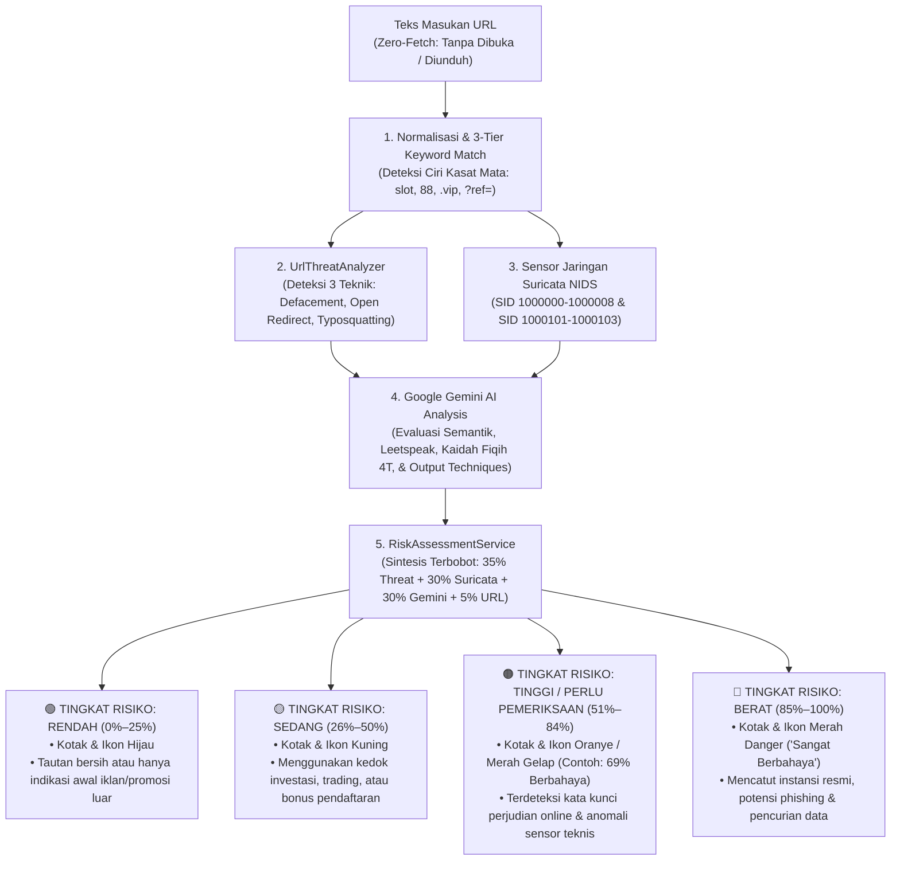

# 🛡️ Panduan Terpadu Indikator & Ciri-Ciri Tautan Judi Online (Judol)
## Integrasi Ciri Kasat Mata (Konvensional) dan 3 Teknik Penyusupan Siluman Modern
**Aswaja CyberShield — Platform Literasi & Keamanan Siber Berbasis Nilai Islam**

Dokumen ini merupakan **rujukan teknis dan edukatif terpadu** yang menggabungkan seluruh indikator tautan **Judi Online (*Judol / Maysir Modern*)** dan **Investasi Menyesatkan**, mencakup **ciri-ciri yang terlihat (*kasat mata / konvensional*)** hingga **3 teknik penyusupan canggih (*siluman / stealth evasion*)** yang digunakan oleh sindikat kejahatan siber modern.

---

## 📌 1. Evolusi Modus Operandi: Mengapa Sindikat Beralih?

Perang melawan sindikat perjudian daring di Indonesia mengalami pergeseran taktik yang signifikan:

```
┌──────────────────────────────────────────────────────────┐      ┌──────────────────────────────────────────────────────────┐
│             FASE 1: ERA KONVENSIONAL (KASAT MATA)        │      │          FASE 2: ERA PENYUSUPAN (STEALTH)        │
├──────────────────────────────────────────────────────────┤      ├──────────────────────────────────────────────────────────┤
│ • Membuat domain baru dengan kata kunci judi langsung.   │      │ • Menunggangi otoritas domain resmi pemerintah/kampus.   │
│ • Menggunakan TLD murahan (.vip, .top, .xyz).            │ ───► │ • Memanfaatkan celah Open Redirect untuk cloaking URL.   │
│ • Mudah terdeteksi oleh filter DNS & TrustPositif.       │      │ • Memalsukan merek/lembaga dengan serangan homoglif.     │
│ • Rentang hidup domain sangat singkat (1–7 hari).        │      │ • Bertahan lebih lama di indeks mesin pencari (SEO).     │
└──────────────────────────────────────────────────────────┘      └──────────────────────────────────────────────────────────┘
```

Untuk menghadapi kedua fase tersebut secara bersamaan, sistem **Aswaja CyberShield** menggabungkan deteksi pola heuristik kasat mata dengan analisis struktural mendalam melalui **`UrlThreatAnalyzer`**, **Suricata NIDS**, dan **Google Gemini AI**.

---

## 2. Bagian I: Ciri-Ciri Tautan Judol yang Terlihat (Kasat Mata / Konvensional)

Ciri-ciri ini merupakan karakteristik visual dan struktural yang dapat langsung dikenali oleh pengguna cermat atau sensor heuristik awal:

### 2.1. Ciri Struktur Teks URL & Domain
1. **Pola Kata Kunci Eksplisit Taruhan:**
   - Menyematkan frasa perjudian terang-terangan pada nama domain atau jalur URL: `slot`, `gacor`, `maxwin`, `togel`, `casino`, `kasino`, `scatter`, `rtp-live`, `zeus`, `olympus`, `pragmatic`, `pgsoft`, `taruhan`, `sbobet`.
2. **Angka Keberuntungan / Hoki Sindikat:**
   - Penyematan angka khas sindikat judi pada nama host: `88`, `138`, `777`, `888`, `303`, `168` (contoh: `cuan-vip88.vip`, `gacor777.top`, `slot138.site`).
3. **Ekstensi Domain (TLD) Murah & Sekali Buang (*Fast-Flux*):**
   - Menggunakan TLD berbiaya murah yang minim verifikasi identitas pendaftar: `.vip`, `.top`, `.xyz`, `.cc`, `.click`, `.fun`, `.site`, `.icu`, `.monster`, `.club`, `.live`.
4. **Rangkaian Tanda Hubung Berlebih (*Hyphen Chaining*):**
   - Menggunakan 2 atau lebih tanda hubung berturut-turut untuk merangkai kata kunci promosi atau mengelabui filter merek (contoh: `cuan-trading-harian-vip88.vip`, `dana-kaget-resmi-indonesia.site`).
5. **Jalur Parameter Transaksi Deposit Kilat:**
   - Jalur URL yang mengarahkan langsung ke modul perbankan/e-wallet taruhan: `/deposit`, `/deposit-dana`, `/deposit-qris`, `/depo-pulsa`, `/depo-10k`, `/form-deposit`.
6. **Parameter Afiliasi / Perekrutan Member:**
   - Parameter query untuk melacak agen dan komisi perekrutan pemain baru: `?ref=agen123`, `?aff=`, `?agent=`, `?referral=`.

### 2.2. Ciri Narasi, Tampilan, & Muatan Landing Page (*Red Flags*)
1. **Janji Keuntungan Pasti (*Zero-Risk Fallacy*):**
   - Klaim tidak wajar yang menentang kaidah pasar finansial: *"Cuan 30%/hari"*, *"Robot trading anti rugi"*, *"Bocoran pola admin gacor 99% pasti menang"*.
2. **Sistem Deposit Bersyarat (*Jebakan Turnover / TO*):**
   - Dana yang sudah masuk tidak dapat ditarik (*withdraw*) sebelum korban mencapai volume putaran taruhan tertentu (*Turnover 5x - 20x*) atau meminta transfer deposit lanjutan sebagai "biaya aktivasi".
3. **Tampilan Visual Agresif & Gamifikasi:**
   - Roda putar keberuntungan acak fiktif (*Live Spin Wheel*), banner berkedip mencolok, dan notifikasi pencairan dana palsu yang terus bergerak (*fake live withdrawal*).
4. **Rekrutmen Referral Agresif (Skema Ponzi Judol):**
   - Imbalan bonus besar jika berhasil mengajak anggota baru menyetor modal — ciri percampuran skema piramida maysir.

---

## 3. Bagian II: Ciri-Ciri Tautan Judol yang Menggunakan 3 Teknik Penyusupan Siluman

Sindikat modern menggunakan teknik rekayasa URL canggih agar tautan terlihat seperti situs sah, resmi, atau edukatif:

```
                                  3 TEKNIK PENYUSUPAN TAUTAN JUDOL
 ┌──────────────────────────────────────────────┬─────────────────────────────────────────────┬────────────────────────────────────────────┐
 │ 1. Web Defacement & Subdomain Hijacking      │ 2. Open Redirect (Cloaking)                 │ 3. Typosquatting / URL Spoofing            │
 ├──────────────────────────────────────────────┼─────────────────────────────────────────────┼────────────────────────────────────────────┤
 │ • Menyusup ke CMS portal pemerintah (.go.id) │ • Memanfaatkan parameter query pengalihan   │ • Mendaftarkan domain yang sangat mirip    │
 │   atau perguruan tinggi (.ac.id, .sch.id).   │   (?url=, ?redirect=, ?to=, ?dest=, ?link=).│   dengan lembaga resmi (OJK, BI, Bank).    │
 │ • Menaruh file di folder unggahan berkas     │ • Tautan tampak resmi saat dibagikan,       │ • Serangan visual homoglif (0→o, 1→l, rn→m)│
 │   (/wp-content/uploads/, /journal/, /files/).│   namun otomatis me-redirect korban ke      │ • Menyematkan imbuhan tipuan (-resmi,      │
 │ • Mengambil alih subdomain terbengkalai      │   alamat judol di TLD murah (.vip, .xyz).   │   -login, -bansos, -bantuan, -daftar).     │
 │   (DNS dangling / CNAME takeover).           │ • Menggunakan URL-encoding berlapis ganda.  │ • Menggunakan TLD komersial (.com, .net).  │
 └──────────────────────────────────────────────┴─────────────────────────────────────────────┴────────────────────────────────────────────┘
```

### 3.1. Teknik 1: Web Defacement & Subdomain Hijacking
* **Target Incaran:** Domain institusi bereputasi tinggi yang dilindungi:
  - `.go.id` (Pemerintah Pusat/Daerah)
  - `.ac.id` (Perguruan Tinggi / Universitas)
  - `.sch.id` (Sekolah)
  - `.mil.id` (Militer)
  - `.desa.id` (Pemerintahan Desa)
* **Ciri & Bukti Teknis:**
  1. **Folder Unggahan CMS Rentan:** Tautan resmi disusupi halaman judi pada folder publik CMS (WordPress, Joomla, Open Journal System):
     - `https://dinas.pemkab.go.id/wp-content/uploads/2026/03/slot-gacor/`
     - `https://universitas.ac.id/journal/files/maxwin88/`
  2. **Subdomain Liar (Subdomain Hijacking):** Subdomain yang menyematkan angka hoki atau kata kunci judi di bawah domain induk resmi:
     - `https://slot88.bappeda.go.id/`
     - `https://gacor777.desa.desa.id/`
* **Mengapa Sangat Berbahaya?** Karena domain induk memiliki reputasi tinggi di mesin pencari Google (*SEO Authority*), sehingga tautan judol ini dapat menduduki halaman pertama hasil pencarian dan lolos dari pemblokiran otomatis.

### 3.2. Teknik 2: Open Redirect (Cloaking / Pembelokan URL Otomatis)
* **Mekanisme:** Mengeksploitasi fitur pengalihan tautan (*redirector*) pada aplikasi web resmi yang tidak memvalidasi parameter tujuan pengalihan.
* **Ciri & Bukti Teknis:**
  1. **Parameter Query Pengalihan:** Ditemukan nama parameter pemindah halaman pada URL resmi:
     - `url`, `redirect`, `redirect_uri`, `to`, `link`, `dest`, `next`, `goto`, `return`, `target`, `r`, `u`.
  2. **Dua Host dalam Satu URL:** Bagian awal URL menggunakan domain terpercaya, tetapi parameternya memuat URL eksternal lengkap yang mengarah ke situs judi:
     - `https://kampus.ac.id/login?redirect=https://cuan-trading-vip88.vip/slot`
  3. **Percent-Encoding Berlapis (*Multi-Layer Obfuscation*):** Mengaburkan karakter tanda titik dua (`:`) dan garis miring ganda (`//`) agar tidak terbaca oleh filter URL sederhana:
     - `https://portal.go.id/out?url=https%3A%2F%2Fslot-gacor.xyz`
     - Bahkan menggunakan *double-encoding* (`%252F%252F`).
  4. **Target Akhir Bermuara ke TLD Murah / Judol:** Parameter pengalihan selalu mengarah ke domain tidak resmi berekstensi murah (`.vip`, `.top`, `.cc`) yang memuat sistem deposit judi.

### 3.3. Teknik 3: Typosquatting & Homoglyph URL Spoofing
* **Mekanisme:** Membuat domain baru yang secara visual menyerupai lembaga resmi pengawas keuangan atau perbankan guna menjebak korban yang kurang teliti.
* **Ciri & Bukti Teknis:**
  1. **Substitusi Karakter Homoglif (*Visual Impersonation*):** Mengganti karakter huruf dengan angka atau kombinasi huruf yang bentuk geometrisnya identik:
     - Angka `0` untuk huruf `O` (contoh: `0jk-investasi.com` $\to$ meniru `ojk.go.id`).
     - Angka `1` untuk huruf `l` atau `i` (contoh: `b1-resmi.com` $\to$ meniru `bi.go.id`).
     - Huruf `rn` untuk huruf `m` (contoh: `bca-klaim.corn` $\to$ meniru `.com`).
     - Huruf `vv` untuk huruf `w`.
  2. **Pencatutan Nama Lembaga pada TLD Komersial:**
     - Menggunakan nama lembaga negara yang seharusnya `.go.id`, tetapi didaftarkan pada ekstensi komersial bebas verifikasi:
       - `ojk-investasi-amanah.com` (Palsu) vs `ojk.go.id` (Resmi).
       - `bappebti-trading-syariah.net` (Palsu) vs `bappebti.go.id` (Resmi).
  3. **Penyematan Embel-Embel Tipuan (*Deceptive Suffixes*):**
     - Menambahkan kata penenang psikologis: `-resmi`, `-info`, `-login`, `-daftar`, `-bansos`, `-bantuan`, `-dana`, `-klaim`.

### 3.4. Teknik 4: URL Masking & Domain Rebouncer (Penyembunyian Tautan di Balik Ekosistem Tepercaya)
* **Mekanisme:** Sindikat menyamarkan tautan situs judi atau platform *Binary Options* ilegal menggunakan domain resmi layanan raksasa teknologi (seperti `share.google`, `app.goo.gl`, Google Docs/Drive, atau shortener populer `bit.ly`, `s.id`, `linktr.ee`).
* **Ciri & Bukti Teknis:**
  1. **Domain Pembungkus Tepercaya:** Tautan yang disebar di media sosial/WhatsApp tampak sangat aman (`https://share.google/dZPBsDvJTBpwcuDLo`).
  2. **Jembatan Pengalihan Otomatis (*Rebouncer/Proxy*):** Begitu dibuka, layanan perantara langsung mengalihkan korban ke situs tujuan sebenarnya (`https://olymptrade.com/`).
* **Penanganan Aswaja CyberShield:** Mesin *Unmasking* menelusuri rantai pengalihan HTTP untuk mengekstrak URL tujuan akhir, lalu mengaudit situs target secara penuh dan menetapkan vonis berbahaya (70% - 100%).

### 3.5. Teknik 5: SEO Cloaking / Conditional Defacement (Manipulasi Mesin Pencari Googlebot)
* **Mekanisme:** Skrip backdoor disusupkan pada web server domain resmi pemerintah (`.go.id`) atau akademik (`.ac.id`). Skrip ini memeriksa *User-Agent* perayap:
  - **Jika Pengunjung Manusia (Browser Biasa):** Disajikan halaman berita kedinasan normal agar pengelola situs dan masyarakat umum tidak curiga.
  - **Jika Robot Mesin Pencari (*Googlebot*):** Disajikan halaman promosi judi online masif (`CUMI787 : Situs Slot Gacor Hari Ini Slot88 Pasti JP Maxwin`) agar hasil pencarian Google terisi tautan judi sindikat.
* **Studi Kasus Forensik Riil:**
  - URL yang Diuji: `https://bbpkapdn1.kemendagri.go.id/`
  - Respon Manusia: HTTP 200, 30 KB, Judul `Berita & Peristiwa`.
  - Respon Googlebot: HTTP 200, **523 KB**, Judul `CUMI787 : Asli Paten Situs Slot Gacor Hari Ini Dengan Permainan Slot88 Resmi Pasti Kasih JP Maxwin`!
* **Penanganan Aswaja CyberShield:** Mesin **Dual-Persona Fetching** membandingkan kedua tampilan secara simultan. Jika ditemukan diskrepansi konten judol pada crawler, sistem langsung menetapkan skor **95% Kritis (Waspada: Terindikasi Penyusupan SEO Cloaking)**.

---

## 📊 4. Matriks Komparasi Lengkap (Kasat Mata vs 3 Teknik Siluman)

| Dimensi Evaluasi | Ciri Kasat Mata (Konvensional) | 3 Teknik Penyusupan Siluman |
| :--- | :--- | :--- |
| **Bentuk Tautan URL** | `https://slot-gacor-vip88.vip/deposit` | `https://instansi.go.id/wp-content/uploads/slot/`<br>`https://portal.ac.id/out?url=https%3A%2F%2Fjudol.vip`<br>`https://0jk-bantuan-resmi.com` |
| **Domain yang Digunakan** | Domain baru ber-TLD murah (`.vip`, `.top`, `.xyz`, `.cc`). | Domain resmi institusi (`.go.id`, `.ac.id`) atau domain tiruan ber-homoglif. |
| **Metode Penyamaran** | Mengandalkan tanda hubung dan leetspeak sederhana (`sl0t`). | Eksploitasi celah server (CMS Defacement, Open Redirect, DNS Hijacking, Homoglif). |
| **Tingkat Kemudahan Dideteksi** | **Sangat Mudah** (Dapat dilihat langsung oleh mata awam). | **Sangat Sulit** (Tampak 100% seperti link resmi jika tidak dianalisis secara struktural). |
| **Dampak Terhadap Korban** | Korban yang sadar akan langsung curiga melihat nama domain aneh. | Korban percaya penuh karena tautan berakhiran `.go.id` atau mencatut nama regulator OJK. |
| **Sensor Pendeteksi di Aswaja CyberShield** | • `UrlValidationService` (3-Tier Keyword Match)<br>• Suricata NIDS (SID `1000001` - `1000008`) | • **`UrlThreatAnalyzer.php`** (Analisis Zero-Fetch)<br>• Suricata Local Rules (SID `1000101`, `1000102`, `1000103`)<br>• Google Gemini AI (Semantik Context & Techniques Parsing) |
| **Tampilan di AI Tabayyun** | Vonis **Berbahaya** + skor risiko tinggi + peringatan kata kunci taruhan. | Vonis **Berbahaya** + skor bahaya tinggi + bagian khusus **"Teknik yang Terdeteksi"** (*Web Defacement*, *Open Redirect*, atau *Typosquatting*). |

---

## ⚙️ 5. Cara Aswaja CyberShield Mendeteksi Keduanya Secara Terintegrasi

Sistem keamanan **Aswaja CyberShield** mengintegrasikan deteksi kedua spektrum tersebut melalui pipeline 5 tahap:



### Aturan Penguatan Kombinasi (*Amplified Risk Rules*)
Satu indikator tunggal yang lemah (misal kata mitologi "zeus" pada portal budaya) tidak akan memvonis berbahaya. Namun jika terjadi **kombinasi indikator**:
1. Domain `.go.id` **BERTEMU** path `/wp-content/uploads/` dan kata kunci judi $\rightarrow$ **Vonis Kritis Web Defacement (Skor Bahaya 90–98%)**.
2. Parameter `?url=` **BERTEMU** target TLD `.vip` atau kata kunci judi $\rightarrow$ **Vonis Kritis Open Redirect (Skor Bahaya 90–98%)**.
3. Domain komersial `.com` **BERTEMU** nama instansi resmi OJK/Bappebti dan embel-embel `-resmi` $\rightarrow$ **Vonis Kritis Typosquatting (Skor Bahaya 90–98%)**.

---

## ⚖️ 6. Panduan Tindakan Masyarakat Sesuai Prinsip Tabayyun 4T

Jika pengguna menemukan salah satu dari kedua jenis tautan di atas:
1. **Tawaqquf (Menahan Diri):** Jangan klik tautan, jangan isi formulir, dan jangan transfer deposit apa pun meskipun ada desakan waktu atau iming-iming bonus.
2. **Tastabbus (Memeriksa Ciri Kasat Mata):** Perhatikan apakah domain menggunakan ekstensi aneh (`.vip`, `.top`), nama berbelit-belit, atau menyematkan angka hoki (`88`, `777`).
3. **Tatsabbut (Verifikasi Silang di AI Tabayyun):** Salin teks tautan dan periksa di menu **AI Tabayyun** (`/tabayyun`) untuk membongkar apakah ada teknik *Defacement*, *Open Redirect*, atau *Typosquatting* yang tersembunyi.
4. **Ta'aqqul (Mengambil Tindakan Bertanggung Jawab):** Tekan tombol **"Laporkan Tautan Ini"** untuk mengirim aduan ke Portal Lapor Siber (`/lapor`) agar nomor rekening penampung dan domain sindikat segera diblokir demi melindungi masyarakat luas.

---

## 📋 7. Tabel Standarisasi 4 Tingkat Risiko Resmi & Kasus Uji Nyata

Berikut adalah spesifikasi implementasi 4 tingkatan risiko yang telah diselaraskan pada backend, frontend, sensor IDS, dan tampilan untuk orang awam:

| Tingkat Risiko | Rentang Skor | Warna & Ikon | Karakteristik & Indikator Deteksi | Contoh URL Uji Coba | Narasi Rangkuman Awam (*Layman Summary*) |
| :--- | :--- | :--- | :--- | :--- | :--- |
| 🟢 **Rendah** | **0% – 25%** | **Hijau** (`emerald`)<br>`verified_user` | Domain resmi berizin, reputasi bersih, terdaftar di *whitelist* institusi pemerintah/akademik, tidak ada pola maysir. | `https://ojk.go.id/`<br>`https://unmul.ac.id/` | **Aman Dikunjungi:** Alamat situs resmi yang sah tanpa tanda perjudian atau pencurian data. Tetap terapkan kehati-hatian digital. |
| 🟡 **Sedang** | **26% – 50%** | **Kuning** (`amber`)<br>`warning` | Domain menggunakan akhiran bebas/murah (`.club`, `.site`), tanda hubung promosi, atau klaim investasi/trading tanpa izin resmi, **namun bersih dari konten judi langsung**. | `https://komunitas-pecinta-kucing.club/forum`<br>`https://bisnis-cuan-harian.site/` | **Perlu Kewaspadaan:** Menggunakan domain bebas tanpa verifikasi atau klaim keuntungan instan, namun **tidak ditemukan transaksi judi slot**. Jangan bagikan sandi atau modal. |
| 🟠 **Tinggi / Perlu Pemeriksaan** | **51% – 84%** | **Oranye** (`orange`)<br>`gpp_maybe` | Terdeteksi kata kunci fitur taruhan judi (seperti *maxwin, jackpot, scatter, rtp*) atau anomali sensor teknis ganda tanpa izin otoritas. | `https://maxwin.lc/`<br>`https://jackpot-scatter.site/` | **Perlu Pemeriksaan Lanjutan:** Tautan memuat fitur yang identik dengan taruhan daring. Berpotensi mengarahkan ke jaringan judi. Jangan tekan tombol pendaftaran. |
| 🔴 **Berat / Sangat Berbahaya** | **85% – 100%** | **Merah** (`red`)<br>`gpp_bad` | Terbukti langsung sarana judi online aktif (slot gacor, togel, casino), penyusupan siber (*Web Defacement*), pemalsuan identitas (*Typosquatting/Phishing*), atau pengalihan tertutup (*Cloaking*). | `https://cuan-trading-harian-vip88.vip/deposit-slot`<br>`https://instansi.go.id/uploads/slotgacor/` | **Sangat Berbahaya:** Terbukti sebagai sarana perjudian ilegal atau pencurian data sandi/rekening. Jangan pernah mentransfer uang dan segera tutup halaman. |
