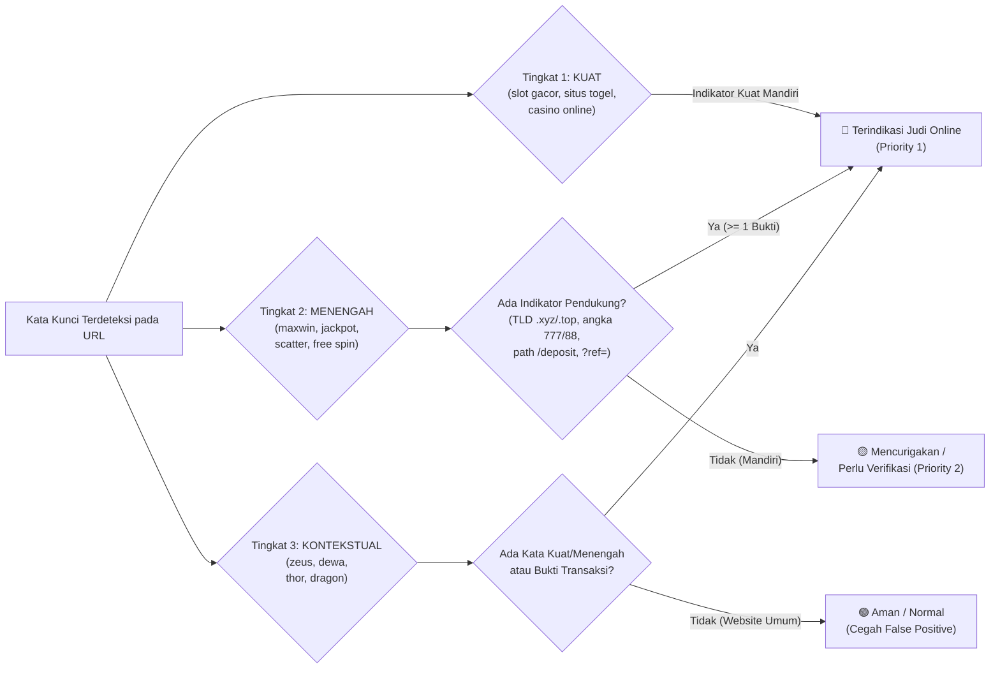

# Dasar Teori & Landasan Keilmuan: Aswaja CyberShield
## Integrasi Fiqih Informasi Ahlussunnah wal Jama'ah, Keamanan Jaringan Suricata NIDS, dan Kecerdasan Buatan Ganda (Dual AI)

Dokumen ini memuat **landasan teori ilmiah, teologis/fiqih, keamanan siber, dan pemodelan matematis** yang menjadi fondasi pembangunan platform **Aswaja CyberShield**. Dokumen ini disusun sebagai rujukan akademis bagi laporan karya tulis, presentasi kompetisi, dan tanya-jawab dewan juri.

---

## 1. Teori Rekayasa Sosial (*Social Engineering*) & Beban Ganda Pemuda Digital

### 1.1. Pergeseran Ancaman Siber: Dari Eksploitasi Sistem ke Eksploitasi Psikologis
Dalam literatur keamanan informasi modern (Mitnick & Simon, *The Art of Deception*), mayoritas insiden penipuan digital pada masyarakat umum tidak lagi terjadi akibat peretasan kriptografi tingkat lanjut, melainkan melalui **Rekayasa Sosial (*Social Engineering*)** — yaitu manipulasi psikologis yang memanfaatkan ketergesaan (*urgency*), ketamakan (*greed/high-yield promise*), ketakutan (*fear*), serta kepedulian sosial/keagamaan korban.

### 1.2. Fenomena Dua Kluster Kejahatan Digital Utama di Indonesia
Di ruang komunikasi masyarakat Indonesia, ancaman rekayasa sosial paling merusak terkonsentrasi pada dua domain:
1. **Perjudian Daring (*Judi Online / Judol*):** Menggunakan algoritma pemikat kemenangan awal (*pseudo-random reinforcement*), istilah gamifikasi (*slot gacor, maxwin, RTP live, scatter*), serta rotasi domain berkecepatan tinggi (*fast-flux domain*) untuk menghindari pemblokiran DNS pemerintah.
2. **Investasi Menyesatkan (*Investasi Bodong / Skema Ponzi*):** Mencatut nama regulator resmi (OJK, Bappebti) atau menggunakan embel-embel "Syariah / Amanah" untuk menjanjikan imbal hasil pasif tidak masuk akal (*guaranteed high return without risk*).

---

## 2. Landasan Teologis & Fiqih Informasi Ahlussunnah wal Jama'ah (Aswaja)

Platform **Aswaja CyberShield** mentransformasikan khazanah keilmuan Islam moderat (*Wasathiyah*) ke dalam arsitektur sistem informasi modern:

### 2.1. Teori Tabayyun & Kritik Sanad Digital
Landasan normatif utama verifikasi informasi digital berakar pada firman Allah SWT dalam **QS. Al-Hujurat Ayat 6**:
> *"Wahai orang-orang yang beriman! Jika seseorang yang fasik datang kepadamu membawa suatu berita, maka telitilah kebenarannya (fatabayyanuu), agar kamu tidak mencelakakan suatu kaum karena kebodohan (kecerobohan), yang akhirnya kamu menyesali perbuatanmu itu."*

Dalam metodologi ilmu hadits Ahlussunnah wal Jama'ah, kesahihan suatu kabar diuji melalui dua aspek:
1. **Naqd as-Sanad (Kritik Sanad / Rantai Sumber):** Dalam konteks siber, *sanad* diwujudkan melalui **verifikasi otoritas domain, sertifikat kriptografi TLS/SSL, reputasi TLD, dan keaslian institusi penyelenggara (OJK/Bappebti)**.
2. **Naqd al-Matn (Kritik Matan / Substansi Isi):** Dalam konteks siber, *matan* diwujudkan melalui **analisis semantik dan logika isi penawaran oleh Dual AI** untuk mendeteksi anomali janji keuntungan fiktif atau ajakan taruhan.

### 2.2. Empat Pilar Wasathiyah Aswaja dalam Arsitektur Fitur
Empat nilai karakter dasar Ahlussunnah wal Jama'ah dipetakan secara fungsional ke dalam 4 modul utama aplikasi:

| Pilar Wasathiyah Aswaja | Makna Filosofis & Etika Siber | Implementasi Modul Aplikasi |
| :--- | :--- | :--- |
| **1. Tawasuth** (*Moderat / Objektif*) | Bersikap adil di jalan tengah, tidak menghakimi tanpa bukti, dan berpegang pada verifikasi data silang yang terukur. | **AI Tabayyun Link Checker** (`tabayyun.blade.php`): Memeriksa tautan dengan korelasi multi-sensor (Suricata + Dual AI) dan sistem *3-Tier Matching* agar tidak terjadi tuduhan palsu (*false positive*). |
| **2. Tawazun** (*Keseimbangan*) | Menyeimbangkan kecanggihan teknologi keamanan siber dengan kecerdasan moral, adab bermedia sosial, dan literasi fiqih. | **Modul Etika & Fiqih Siber** (`etika.blade.php`): Menyajikan panduan adab digital, perlindungan privasi keluarga, dan 6 kajian fiqih kontemporer. |
| **3. I'tidal** (*Tegak Lurus / Tegas*) | Berani bertindak tegas membela kebenaran dan melindungi masyarakat dari kemudaratan finansial maupun moral. | **Portal Lapor Siber** (`lapor.blade.php`): Kanal pengaduan publik bertiket (`LPRxxx`) untuk menindak tautan judi online dan rekening penipuan. |
| **4. Tasamuh** (*Bijaksana & Edukatif*) | Membimbing masyarakat yang awam teknologi dengan pendekatan simulasi yang ramah, simpatik, dan tidak menghakimi. | **Cyber Guard Interactive Test** (`cyber-guard.blade.php`): Simulasi kuis studi kasus interaktif untuk melatih refleks menghadapi penipuan. |

### 2.3. Metodologi Operasional Prinsip 4T
Sebagai tahapan kerja praktis saat menerima tautan atau pesan mencurigakan, digunakan **Metodologi 4T**:
1. **Tawaqquf (Menahan Diri):** Berhenti sejenak (*zero-click reflex*), tidak langsung mengeklik tautan atau mengunduh berkas `.apk` saat emosi dipancing.
2. **Tastabbus (Meneliti Substansi):** Memeriksa apakah isi klaim rasional atau mengandung unsur manipulasi (*gharar/maysir*).
3. **Tatsabbut (Memverifikasi Bukti & Sanad):** Memeriksa keabsahan domain dan rekam jejak jaringan melalui mesin **AI Tabayyun**.
4. **Ta'aqqul (Menimbang Maslahat & Mudarat):** Memastikan informasi membawa manfaat sebelum disebarkan ke grup keluarga/komunitas.

### 2.4. Landasan Maqashid Syariah & Fiqih Muamalah
Pencegahan tautan Judi Online dan Investasi Bodong merupakan bagian dari **Maqashid Syariah (Tujuan Utama Hukum Islam)**:
- **Hifzhul Maal (Menjaga Harta):** Melindungi harta masyarakat dari praktik **Maysir** (perjudian spekulatif *zero-sum game* yang diharamkan dalam QS. Al-Ma'idah: 90) dan **Gharar / Aklu Amwalin Nas bil Bathil** (penipuan investasi bodong yang memakan harta sesama secara batil sebagaimana dilarang dalam QS. An-Nisa: 29).
- **Hifzhul 'Irdh & Hifzhun Nafs (Menjaga Kehormatan & Jiwa):** Mencegah pencurian data pribadi (*phishing*) dan kehancuran ekonomi keluarga akibat jeratan judi daring.

---

## 3. Teori Pertahanan Berlapis (*Defense-in-Depth*) & Suricata NIDS

### 3.1. Konsep *Defense-in-Depth* (Mengapa AI Saja Tidak Cukup?)
Dalam rekayasa keamanan siber, mengandalkan satu lapisan deteksi saja (*Single Point of Detection*) memiliki celah fatal:
- **Kelemahan Deteksi Signature Murni:** Mudah dikelabui oleh kata-kata baru yang disamarkan (*obfuscation*), teknik defacement, open redirect, atau narasi penipuan yang belum terdaftar di *database rule*.
- **Kelemahan AI (LLM) Murni:** Bersifat probabilistik, tidak dapat melihat paket jaringan mentah (*network blind*), dan rentan terhadap *prompt injection*.

Oleh sebab itu, **Aswaja CyberShield** menerapkan teori **Defense-in-Depth Hibrida (Zero-Fetch)** yang menggabungkan:
1. **Lapisan Deterministik Jaringan (Suricata NIDS — Layer 3/4/7)**
2. **Lapisan Struktur URL & 3 Teknik Penyusupan Tautan (`UrlThreatAnalyzer`)**
3. **Lapisan Kognitif Semantik (Google Gemini AI — Layer 7)**
4. **Lapisan Heuristik Struktur URL (3-Tier Keyword Matching)**

### 3.2. Teori *Network Intrusion Detection System* (Suricata NIDS) & Telemetri `eve.json`
**Suricata** adalah mesin NIDS *multi-threaded* yang bekerja dengan melakukan *Deep Packet Inspection* (DPI) terhadap lalu lintas jaringan dan menghasilkan log berformat **EVE JSON (*Extensible Event Format*)** di [`backend/storage/logs/suricata/eve.json`](file:///d:/aswajaCyber/backend/storage/logs/suricata/eve.json).

Tiga titik inspeksi protokol utama yang digunakan dalam sistem ini:
1. **Inspeksi Protokol DNS (`dns.query` / `rrname`):** Mendeteksi permintaan resolusi nama domain ke server perjudian atau investasi ilegal pada paket UDP/TCP Port 53 sebelum koneksi TCP terbentuk.
2. **Inspeksi Protokol TLS SNI (`tls.sni`):** Pada koneksi HTTPS terenkripsi, meskipun *payload* halaman dienkripsi, nama domain tujuan tetap dikirim dalam bentuk teks terbuka (*plaintext*) di dalam ekstensi **Server Name Indication (SNI)** saat paket `ClientHello` dikirimkan. Suricata mengekstrak `tls.sni` ini untuk mendeteksi domain judi online meskipun menggunakan HTTPS.
3. **Inspeksi Protokol HTTP (`http.hostname` & `http.uri`):** Mencocokkan pola *Regular Expression* (*PCRE*) terhadap rute transaksi seperti `/deposit-qris`, `/depo-pulsa`, `/auto-profit`, dan parameter afiliasi `?ref=`.

---

## 4. Teori Heuristik URL & Pencocokan Kata Kunci Berjenjang (*3-Tier Keyword Matching*)

### 4.1. Pengendalian *False Positive Rate (FPR)* dalam Sistem Deteksi
Dalam teori klasifikasi biner keamanan informasi, terdapat *trade-off* antara **True Positive Rate (Sensitivity)** dan **False Positive Rate (FPR)**:
$$\text{FPR} = \frac{\text{FP}}{\text{FP} + \text{TN}}$$
Jika sistem menggunakan pencocokan kata kunci datar (*flat keyword matching*) di mana kata-kata mitologi populer seperti `"zeus"`, `"thor"`, `"dewa"`, atau `"dragon"` langsung diberi bobot bahaya tinggi (karena sering dipakai sebagai nama tema permainan slot seperti *Gates of Olympus / Zeus*), maka website ensiklopedia sejarah, artikel budaya, atau portal gim umum akan salah dituduh sebagai situs Judi Online (*High False Positive*).

### 4.2. Teori *3-Tier Contextual Keyword Matching*
Untuk menekan $\text{FPR} \rightarrow 0$ tanpa menurunkan akurasi deteksi, **Aswaja CyberShield** merumuskan arsitektur **Tiga Tingkat Pencocokan Kata Kunci**:

---

## 5. Teori Kognitif AI Semantik & Zero-Fetch URL Threat Analysis

1. **Google Gemini AI (`gemini-3.5-flash-lite`):**
   - Unggul dalam **Analisis Semantik & Pragmatik Bahasa Indonesia**, memahami nuansa kalimat promosi persuasif, klaim keuntungan hiperbolis, penyamaran kata kunci (*leetspeak*: `sl0t`, `g4c0r`), serta pemetaan nilai etika Fiqih Siber 4T.
   - Menggunakan **Proteksi Prompt Injection**: Seluruh masukan teks URL diperlakukan murni sebagai string data pasif, bukan perintah komputasi yang dapat dieksekusi.
2. **Prinsip Zero-Fetch:**
   - Server tidak pernah melakukan HTTP GET/POST ke URL yang diperiksa guna mencegah paparan eksploitasi remote, pelacakan IP server oleh sindikat, maupun pengunduhan malware secara tidak sengaja.
3. **Deteksi 3 Teknik Penyusupan Tautan (`UrlThreatAnalyzer`):**
   - *Web Defacement & Subdomain Hijacking:* Mengevaluasi manipulasi CMS pada domain instansi bereputasi tinggi (`.go.id`, `.ac.id`, `.desa.id`).
   - *Open Redirect:* Mendeteksi parameter pengalihan URL yang disamarkan (*cloaking*).
   - *Typosquatting & Serangan Homoglif:* Mengukur jarak Levenshtein dan substitusi karakter visual (`0` $\to$ `o`, `1` $\to$ `l/i`, `rn` $\to$ `m`).

---

## 6. Model Matematika Sintesis Risiko Multi-Sensor (*Weighted Risk Synthesis*)

Sistem mengambil keputusan akhir secara objektif melalui pemodelan matematika:

### 6.1. Fungsi Skor Anomali Struktur URL ($S_{\text{url}}$)
$$S_{\text{url}} = \min\left(100, \sum_{k=1}^{m} C_k\right)$$
Di mana $C_k$ adalah bobot empiris setiap indikator struktural yang ditemukan pada URL target.

### 6.2. Fungsi Skor Deterministik Suricata ($S_{\text{suricata}}$)
$$S_{\text{suricata}} = \begin{cases} 
95 & \text{untuk Alert Signature Prioritas 1 (Tingkat Kuat / Deposit / Investasi Bodong)} \\
75 & \text{untuk Alert Signature Prioritas 2–3 (Tingkat Menengah / TLD Berisiko / Afiliasi)} \\
0  & \text{untuk Whitelist Regulator (SID 1000000) atau Trafik Bersih}
\end{cases}$$

### 6.3. Fungsi Skor Threat Analyzer ($S_{\text{threat}}$)
$$S_{\text{threat}} = \min\left(100, \sum_{j=1}^{n} W_{\text{tech}, j}\right)$$
Di mana kombinasi teknik berbahaya (misal: open redirect ke domain judol, atau defacement `.go.id`) menghasilkan amplifikasi skor bahaya.

### 6.4. Persamaan Sintesis Rata-Rata Terbobot Proporsional ($\text{RawScore}$)
$$\text{RawScore} = \frac{W_{\text{threat}} \cdot S_{\text{threat}} + W_{\text{suricata}} \cdot S_{\text{suricata}} + W_{\text{gemini}} \cdot S_{\text{gemini}} + W_{\text{url}} \cdot S_{\text{url}}}{\sum W_i}$$
Dengan distribusi bobot standar:
- $W_{\text{threat}} = 0.35$ ($35\%$ — Deteksi 3 teknik penyusupan judol)
- $W_{\text{suricata}} = 0.30$ ($30\%$ — Bukti empiris paket jaringan)
- $W_{\text{gemini}} = 0.30$ ($30\%$ — Analisis semantik kognitif AI)
- $W_{\text{url}} = 0.05$ ($5\%$ — Heuristik penulisan struktur URL)

$$\sum W_{\text{nominal}} = 0.35 + 0.30 + 0.30 + 0.05 = 1.00$$

### 6.5. Sistem Skor 2-State (Aman vs Berbahaya)
Sistem mengadopsi standar biner tegas pada antarmuka publik:
- **Tautan Aman (`normal` / `clean`):** Menampilkan **"Tingkat Keamanan"** ($0\% - 100\%$, hijau emerald).
- **Tautan Berbahaya (`terindikasi_judol` / `terindikasi_investasi` / `mencurigakan`):** Menampilkan **"Tingkat Bahaya"** ($0\% - 100\%$, merah danger). Label penegas *"Sangat Berbahaya"* disematkan hanya jika skor bahaya $\ge 85\%$.
