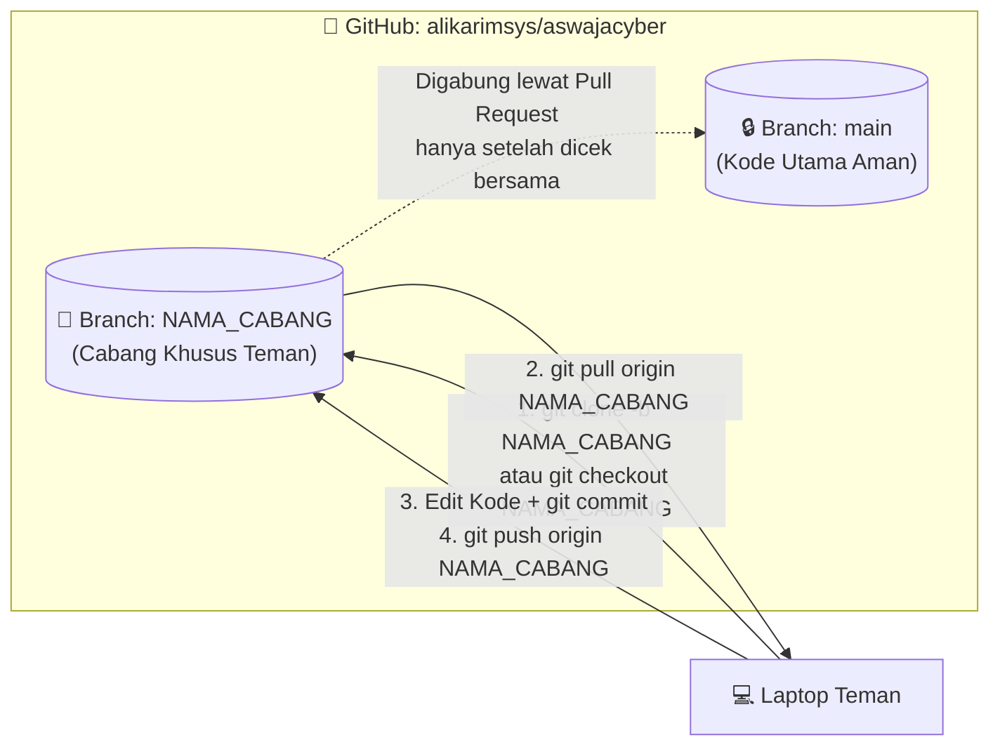

# 🌿 Panduan Git Remote ke Cabang (Branch) untuk Laptop Teman
## Repositori: `https://github.com/alikarimsys/aswajacyber.git`

Dokumen ini berisi panduan langkah demi langkah yang harus dijalankan **di laptop teman kolaborator** untuk terhubung ke **cabang (*branch*) yang sudah ada di GitHub** agar kode utama pada cabang **`main`** dijamin 100% aman dan tidak terganggu.

---

## 📊 Diagram Alur Kerja Cabang Terpisah (Agar `main` Tidak Terganggu)



---

## 1. Syarat Wajib Sebelum Mulai di Terminal
Pastikan teman Anda sudah menerima undangan kolaborator (*Accept Invitation*) di GitHub dengan membuka tautan ini di browsernya:
```text
https://github.com/alikarimsys/aswajacyber/invitations
```
*(Klik tombol hijau **Accept invitation** agar tidak muncul error `403 Permission Denied` saat melakukan `push`).*

---

## 2. Langkah Menghubungkan Laptop Teman ke Cabang di GitHub

Pilih **Kondisi A** atau **Kondisi B** sesuai keadaan laptop teman Anda:

### Kondisi A: Jika di Laptop Teman BELUM Ada Folder Proyeknya (Paling Mudah)
Teman Anda cukup membuka terminal (CMD / PowerShell) dan menjalankan `git clone` yang **otomatis langsung mengarah ke cabang tersebut**:

```cmd
cd D:\
git clone -b deby https://github.com/alikarimsys/aswajacyber.git
cd aswajacyber
```
> 📌 **Catatan:** Ganti tulisan `NAMA_CABANG` dengan nama cabang yang sudah Anda buat di repositori GitHub.

---

### Kondisi B: Jika di Laptop Teman SUDAH Ada Folder Proyeknya
Jika teman Anda sudah memiliki folder proyeknya di laptop, minta ia membuka terminal di dalam folder proyek tersebut lalu jalankan **5 perintah ini secara berurutan**:

```cmd
:: 1. Hapus remote lama
git remote remove origin

:: 2. Hubungkan ke repositori baru (alikarimsys/aswajacyber)
git remote add origin https://github.com/alikarimsys/aswajacyber.git

:: 3. Ambil daftar semua cabang terbaru yang ada di GitHub
git fetch origin

:: 4. Pindah ke cabang yang sudah ada di GitHub
git checkout deby

:: 5. Tarik isi kode terbaru dari cabang tersebut
git pull origin deby
```

---

## 3. Cara Mengecek Apakah Sudah Berada di Cabang yang Benar
Sebelum mulai mengedit kode, teman Anda bisa memastikan posisinya dengan perintah:
```cmd
git branch
```
Pastikan tanda bintang `*` berada pada **`* NAMA_CABANG`** (bukan `* main`).

---

## 4. Cara Teman Menyimpan & Mengirim (*Push*) Kode Nantinya

Setiap kali teman Anda selesai mengedit kode dan ingin mengunggahnya ke GitHub, ia **wajib menyebutkan `NAMA_CABANG`** (jangan `main`):

```cmd
:: 1. Tarik update terbaru dari cabangnya terlebih dahulu
git pull origin deby

:: 2. Simpan semua perubahan
git add .
git commit -m "Update fitur oleh [Nama Teman]"

:: 3. Kirim (push) khusus ke cabang tersebut
git push origin deby
```

Dengan cara ini, seluruh perubahan dari laptop teman Anda hanya akan masuk ke **`deby`** di GitHub, sehingga kode utama di cabang **`main`** tetap aman dan tidak terganggu!

