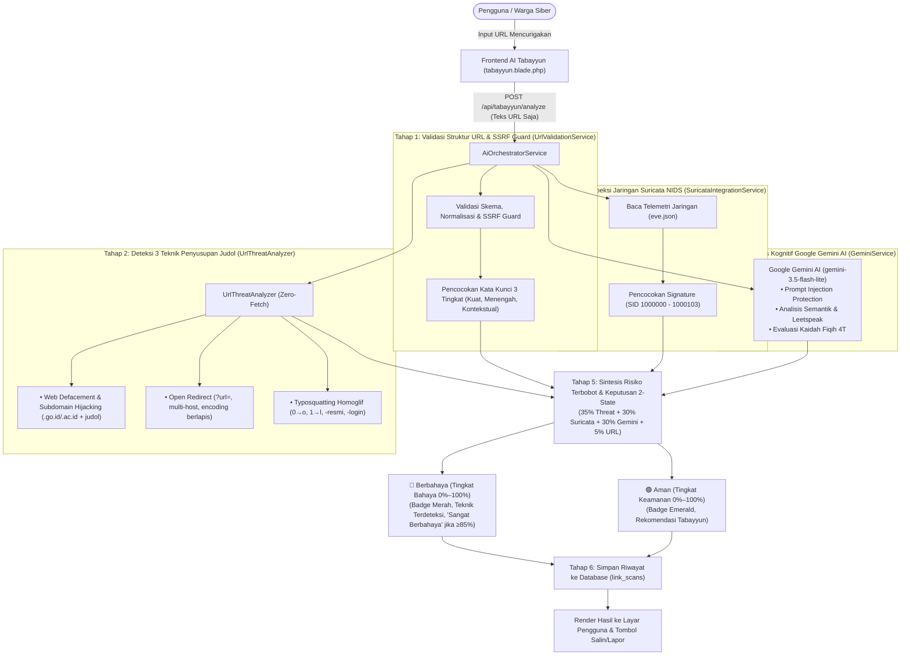

# Aswaja CyberShield

Platform edukasi, verifikasi keabsahan tautan, dan pelaporan terpadu khusus **tautan investasi menyesatkan yang mengarah pada praktik judi online (*judol / maysir modern*)** berlandaskan tradisi Tabayyun dan nilai-nilai **Ahlussunnah wal Jama'ah (Aswaja)**.

---

## 1. Fitur Utama Platform

Aswaja CyberShield dibangun dengan pendekatan **Recognize, Learn, & Act** yang mengintegrasikan fiqih informasi Islam moderat dengan instrumen keamanan siber modern:

### A. Fitur Publik (Masyarakat & Warga Siber)
1. **AI Tabayyun (`/tabayyun` — `frontend/tabayyun.blade.php`)**:
   * **Prinsip Keamanan Zero-Fetch**: Pemeriksaan tautan dilakukan murni berbasis pengujian teks URL tanpa pernah membuka, mengunduh, atau mengeksekusi konten dari tautan target di server.
   * **Deteksi 3 Teknik Penyusupan Tautan Judol (`UrlThreatAnalyzer.php`)**:
     * *Web Defacement & Subdomain Hijacking*: Mendeteksi penyusupan pada domain bereputasi tinggi (`.go.id`, `.ac.id`, `.sch.id`, `.desa.id`), direktori upload CMS (`/wp-content/uploads/`, `/uploads/`), dan angka hoki judol (`88`, `138`, `777`).
     * *Open Redirect (Cloaking)*: Mendeteksi manipulasi parameter pengalihan (`url`, `redirect`, `to`, `dest`, `link`, dll.), URL bertingkat, dan pengalihan ke TLD murahan.
     * *Typosquatting & Homoglif*: Mencocokkan kemiripan dengan lembaga resmi (OJK, Bappebti, BI, Kominfo, bank BUMN) menggunakan substitusi homoglif (`0` $\to$ `o`, `1` $\to$ `l/i`, `rn` $\to$ `m`, `vv` $\to$ `w`) dan embel-embel tipuan (`-resmi`, `-login`, `-bansos`).
   * **Sensor Jaringan Suricata NIDS (`SuricataIntegrationService.php` & `eve.json`)**: Inspeksi paket deterministik pada level DNS, TLS SNI, dan HTTP URI berbasis signature rule standar industri Suricata (SID: 1000000 - 1000103) yang terdaftar di [`infra/suricata/rules/aswaja-local.rules`](file:///d:/cybershield/infra/suricata/rules/aswaja-local.rules).
   * **Google Gemini AI (`GeminiService.php`)**: Mesin kognitif semantik (`gemini-3.5-flash-lite`) yang dilengkapi *prompt injection guard*, evaluasi leetspeak, dan pemetaan kaidah Fiqih 4T.
   * **Standarisasi 4 Tingkat Risiko Resmi (Unified Metric 0%–100%)**:
     * *🟢 Tingkat Risiko Rendah (0%–25%)*: Hijau (`emerald`), status `Aman (Risiko Rendah)`, tautan terverifikasi resmi dan bersih.
     * *🟡 Tingkat Risiko Sedang (26%–50%)*: Kuning (`amber`), status `Sedang / Perlu Waspada`, terindikasi domain bebas/murah atau klaim promosi namun bersih dari judi langsung.
     * *🟠 Tingkat Risiko Tinggi (51%–84%)*: Oranye (`orange`), status `Tinggi / Perlu Pemeriksaan`, terdeteksi kata kunci fitur taruhan judi (maxwin, jackpot, scatter) atau anomali teknis.
     * *🔴 Tingkat Risiko Berat (85%–100%)*: Merah (`red`), status `Sangat Berbahaya (Berat)`, terindikasi kuat sarana judi online aktif, defacement, atau phishing pencurian data.
   * **Rangkuman**: Penjelasan risiko yang padat, lugas, dan bebas dari istilah teknis IT (tanpa istilah TLD, URI, DNS, sensor IDS) agar mudah dipahami masyarakat awam.
   * **Komponen "Teknik yang Terdeteksi"**: Menampilkan badge teknik beserta penjelasan awam dan bukti URL dalam format monospace non-aktif yang aman.
   * **Audit Sanad Domain**: Evaluasi kredibilitas domain dan legalitas institusi regulator resmi (OJK & Bappebti).
   * **Salin Ringkasan Verifikasi & Laporkan**: Tombol salin ringkasan hasil audit untuk dibagikan ke grup percakapan atau diteruskan ke portal aduan (`/lapor?url=...`).

2. **Edukasi & Prinsip 4T Fiqih Medsos (`/etika` & `/artikel/:slug`)**:
   * **Pilar 4T Tabayyun Dinamis**: Metodologi turats klasik (*Tawaqquf, Tastabbus, Tatsabbut, Ta'aqqul*) yang tersinkronisasi langsung dari data admin.
   * **Kajian Fiqih Muamalah Digital**: 6 artikel interaktif seputar adab bermedia sosial, bahaya ghibah digital, perlindungan data pribadi (*satrul 'aurat*), mitigasi phishing APK, menghadapi deepfake, dan muamalah finansial.
   * **Desain Rapi Tanpa Ruang Kosong**: Tata letak terpusat yang padat dan responsif.

3. **Cyber Guard Interactive Test (`/cyber-guard`)**:
   * **Simulasi Skenario Kasus Nyata**: Latihan refleks mendeteksi pesan penipuan berkedok robot trading, game slot, arisan ponzi, dan APK kurir palsu.
   * **Evaluasi & Pembahasan Real-time**: Pembahasan etis dan teknis langsung muncul setelah opsi jawaban dipilih, diakhiri dengan skor kalkulasi otomatis.

4. **Portal Lapor Siber (`/lapor`)**:
   * **Pengaduan URL & Rekening Penipu**: Formulir laporan aduan masyarakat yang dilengkapi upload tangkapan layar dan opsi pelapor anonim (*Hamba Allah*).
   * **Generator ID Tiket Otomatis**: Memberikan nomor tiket unik 3 digit (contoh: `LPR081`) untuk pemantauan tindak lanjut secara transparan.

---

### B. Fitur Panel Admin (`/login` & `/admin`)
1. **Gerbang Login Admin (`/login`)**: Bebas riwayat input (`autocomplete="off"`), dilengkapi proteksi *Inactivity Timeout* (5 menit) dan kebijakan penundaan login bertingkat (*Account Lockout Throttling*).
2. **Dashboard (`/admin`)**: Metrik utama (Jumlah Artikel, Laporan Masuk, Akun Pengelola, Studi Kasus) yang terhubung langsung ke modul terkait, progress breakdown clickable, dan tabel aduan terkini dengan modal pratinjau cepat per baris.
3. **Manajemen Konten (`/admin/artikel`)**: CRUD artikel berbasis 3 rumpun kategori judol (Umum, IT, dan Agama), didukung *Zero-Latency Instant Fallback Rendering* serta tombol aksi ganda (*Edit Kaidah* & *Edit Artikel*) pada kartu pilar 4T (*Tawaqquf, Tastabbus, Tatsabbut, Ta'aqqul*).
4. **Riwayat & Penugasan Laporan (`/admin/laporan`)**: aduan masyarakat, pengubahan status laporan, pencatatan rekomendasi blokir, dan dropdown penugasan staf penangan (*Admin Penangani*) yang sinkron dengan basis data Supabase.
5. **Manajemen Studi Kasus Cyber Guard (`/admin/studi-kasus`)**: CRUD skenario kuis, pilihan jawaban A–D, kunci jawaban, dan narasi pembahasan fiqih siber.
6. **Manajemen Akun Berbasis Peran (`/admin/akun`)**: Pengelolaan akun staf (Super Admin vs Admin Basic), toggle visibilitas kata sandi, dan filter matriks peran instan. Berada di posisi paling bawah pada menu sidebar navigasi.
7. **Arsitektur Sidebar Modern & Absolute Routing**: Navigasi sidebar bersih dengan urutan logis (Dashboard $\to$ Artikel $\to$ Laporan $\to$ Studi Kasus $\to$ Kelola Akun), rute absolut terproteksi redirect otomatis dari `index.php`, dan dialog konfirmasi logout yang aman.

---

## 2. Cara Kerja Sistem (Alur End-to-End)



---

## 3. Formulasi Sintesis Risiko & Skor 2-State

$$\text{RiskScore} = \text{round}\Big((0.35 \times S_{\text{Threat}}) + (0.30 \times S_{\text{Suricata}}) + (0.30 \times S_{\text{Gemini}}) + (0.05 \times S_{\text{URL}})\Big)$$

Sistem mengadopsi panduan biner yang tegas dan jelas:
- **Tautan Aman**: Menampilkan **Tingkat Keamanan** ($0\% - 100\%$, hijau emerald).
- **Tautan Berbahaya**: Menampilkan **Tingkat Bahaya** ($0\% - 100\%$, merah danger). Label penegas *"Sangat Berbahaya"* disematkan hanya jika skor bahaya $\ge 85\%$.

---

## 4. Menjalankan Aplikasi di Lokal (Single-Server Mode)

Dukungan *Smart Front Controller* [`index.php`](file:///d:/cybershield/index.php) memungkinkan seluruh modul antarmuka publik, panel admin, serta backend REST API Laravel berjalan bersamaan hanya dengan **satu perintah**:

```powershell
php -S localhost:3000 index.php
```

* **Aplikasi Publik:** [http://localhost:3000](http://localhost:3000)
* **Panel Administrator:** [http://localhost:3000/login](http://localhost:3000/login) (atau [http://localhost:3000/admin](http://localhost:3000/admin))
* **REST API Endpoint:** [http://localhost:3000/api/ping](http://localhost:3000/api/ping)
* **Runtime Direkomendasikan:** PHP 8.5.12 dengan ekstensi `pdo_pgsql`, `pgsql`, `pdo_sqlite`, `curl`, `mbstring`, `openssl`.

*(Opsional: Jika ingin menjalankan terpisah, backend tetap dapat dijalankan mandiri via `cd backend && php artisan serve` pada port 8000).*

---

## 5. Daftar Variabel Environment Penting (`backend/.env`)

```env
# Database Supabase PostgreSQL (IPv4 Session Pooler)
DB_CONNECTION=pgsql
DB_HOST=aws-0-ap-southeast-1.pooler.supabase.com
DB_PORT=5432
DB_DATABASE=postgres
DB_USERNAME=postgres.tffadqzdhltroeuuckjw
DB_PASSWORD=AswajaCyber3*
DB_SSLMODE=require

# AI Engine Utama (Google Gemini)
GEMINI_API_KEY=your_gemini_api_key_here
GEMINI_MODEL=gemini-3.5-flash-lite
GEMINI_TIMEOUT=30

# Threat Intelligence & RDAP (Zero-Fetch)
THREAT_RDAP_ENABLED=false
THREAT_RDAP_TIMEOUT=2

# Suricata NIDS Integration
SURICATA_ENABLED=true
SURICATA_EVE_PATH=storage/logs/suricata/eve.json
```

---

## 6. Panduan Deployment Vercel Cloud (Opsi 1 Full-Stack)

Aplikasi telah dikonfigurasi penuh untuk deploy monorepo di **Vercel** menggunakan serverless entrypoint [`api/index.php`](file:///d:/cybershield/api/index.php) dan runtime `vercel-php@0.7.3`:

1. **Push ke GitHub:** Pastikan cabang `main` telah sinkron dengan commit terbaru.
2. **Import ke Vercel:** Buka [vercel.com](https://vercel.com), buat New Project, dan import repositori ini.
3. **Konfigurasi Environment:** Masukkan variabel lingkungan dari tabel di atas (`APP_KEY`, `DB_*`, `GEMINI_API_KEY`, dll.) pada Dashboard Vercel Settings.
4. **Deploy Otomatis:** Vercel menjalankan `npm run vercel-build` untuk menginstal dependensi Composer di `backend/` dan menyajikan web Anda secara instan di domain `.vercel.app`.

---

## 7. Hasil Pengujian Otomatis (PHP 8.5)

* **Threat Analyzer Test Suite:** `6 / 6 PASS (100%)` — Deteksi Web Defacement, Subdomain Hijacking, Open Redirect, dan Typosquatting dengan *False Positive = 0*.
* **REST API & RBAC Test Suite:** `15 / 15 PASS (100%)` — Validasi seluruh endpoint publik, sanitasi input, evaluasi kuis, autentikasi admin, dan proteksi hak akses Super Admin.

---

## 8. Dokumen Teknis Pendukung

* [`CATATAN_DATABASE.md`](file:///d:/cybershield/CATATAN_DATABASE.md): Dokumentasi terpadu database Supabase PostgreSQL, 8 tabel master, DDL, dan kontrak sinkronisasi live data.
* [`CATATAN_BACKEND.md`](file:///d:/cybershield/CATATAN_BACKEND.md): Dokumentasi arsitektur Backend Laravel, 10 service utama, unified routing `index.php`, dan formulasi risiko.
* [`CATATAN_FRONTEND.md`](file:///d:/cybershield/CATATAN_FRONTEND.md): Panduan antarmuka publik, tema White Smoke `#F5F5F5`, sistem animasi, siklus loading, dan skor 2-state.
* [`CATATAN_DUAL_AI_DAN_SURICATA.md`](file:///d:/cybershield/CATATAN_DUAL_AI_DAN_SURICATA.md): Integrasi Suricata NIDS, UrlThreatAnalyzer, dan Google Gemini AI.
* [`CATATAN_INDIKATOR_JUDOL.md`](file:///d:/cybershield/CATATAN_INDIKATOR_JUDOL.md): Dokumentasi mendalam 3 teknik penyusupan judol, matriks indikator, dan rule Suricata.
* [`SISTEM_KERJA_WEB.md`](file:///d:/cybershield/SISTEM_KERJA_WEB.md): Alur kerja sistem web menyeluruh dari awal hingga akhir.
* [`PENJELASAN_WEB.md`](file:///d:/cybershield/PENJELASAN_WEB.md): Ringkasan konsep, perumusan masalah, arsitektur panel admin, dan naskah presentasi.

---

&copy; 2026 Aswaja CyberShield &bull; Inisiatif Ketahanan Digital Berbasis Tradisi Tabayyun dan Nilai-Nilai Islam Moderat.
