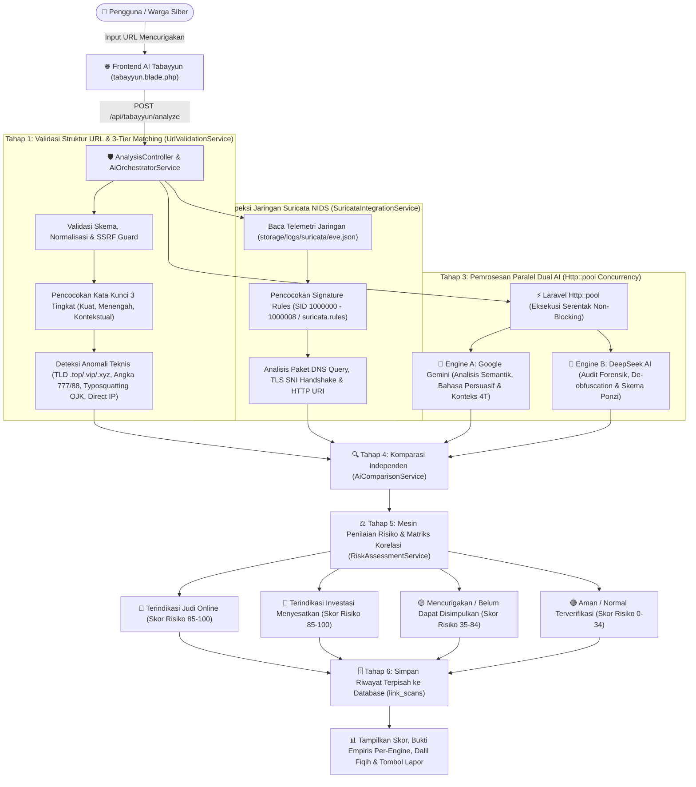
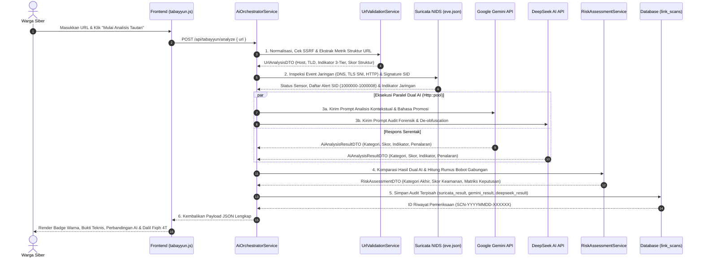

# 🛡️ Aswaja CyberShield

Platform edukasi, verifikasi keabsahan tautan, dan pelaporan terpadu khusus **tautan investasi menyesatkan yang mengarah pada praktik judi online (*judol / maysir modern*)** berlandaskan tradisi Tabayyun dan nilai-nilai **Ahlussunnah wal Jama'ah (Aswaja)**.

---

## 🌟 1. Fitur Utama Platform

Aswaja CyberShield dibangun dengan pendekatan **Recognize, Learn, & Act** yang mengintegrasikan fiqih informasi Islam moderat dengan instrumen keamanan siber modern:

### A. Fitur Publik (Masyarakat & Warga Siber)
1. **AI Tabayyun (`/tabayyun` — `frontend/tabayyun.blade.php`)**:
   * **Layer 1: Sensor Jaringan Suricata NIDS (`SuricataIntegrationService.php` & `eve.json`)**: Inspeksi paket tautan deterministik pada level DNS, TLS SNI, dan HTTP URI berbasis signature rule standar industri Suricata (SID: 1000000 - 1000008) untuk mendeteksi jaringan mesin slot, togel, skema deposit, TLD berisiko (`.top`, `.vip`, `.cc`), dan bypass sensor IP.
   * **Layer 2: Dual AI Parallel Processing (Google Gemini & DeepSeek)**: Pemrosesan serentak via `Http::pool` di mana Gemini menganalisis konteks bahasa dan DeepSeek melakukan audit forensik penalaran independen.
   * **Layer 3: Matriks Korelasi Keputusan & Weighted Synthesis**: Menggabungkan bukti empiris jaringan (Suricata 35%), analisis semantik Gemini (30%), penalaran DeepSeek (30%), dan anomali struktur URL (5%) dengan formula matematis transparan (0–100).
   * **Visualisasi Warna Adaptif (`Light Mode` & `Dark Mode`)**: Kartu hasil analisis (`#tabayyun-result-card`) menyesuaikan warna latar, border, badge, skor, dan kotak temuan secara otomatis berdasarkan hasil verifikasi (`data-alert="red"` untuk *Terindikasi Judol/Investasi Menyesatkan*, `data-alert="amber"` untuk *Mencurigakan*, dan `data-alert="emerald"` untuk *Aman/Normal*) baik pada mode terang maupun gelap.
   * **Audit Sanad Domain**: Evaluasi kredibilitas domain dan legalitas institusi regulator resmi (OJK & Bappebti).
   * **Analisis Mandiri Aman**: Tautan diperlakukan sebagai data tidak tepercaya (*untrusted input*), tanpa eksekusi skrip atau unduhan otomatis.
   * **Fitur Uji Cepat & Salin Ringkasan**: Dilengkapi tombol salin ringkasan hasil audit untuk diteruskan ke grup pesan atau dilaporkan ke Satgas Siber (`/lapor?url=...`).

2. **Edukasi & Prinsip 4T Fiqih Medsos (`/etika` & `/artikel/:slug` — `frontend/etika.blade.php` & `frontend/artikel/`)**:
   * **Pilar 4T Tabayyun Dinamis**: Metodologi turats klasik (*Tawaqquf, Tastabbus, Tatsabbut, Ta'aqqul*) yang tersinkronisasi langsung dari data admin.
   * **Kajian Fiqih Muamalah Digital**: Artikel interaktif seputar adab berkomentar, mitigasi malware APK, perlindungan data pribadi (*satrul 'aurat*), dan bahaya *maysir/gharar* finansial.
   * **Desain Kartu Seragam (Aswaja Emerald)**: Visual konsisten dan elegan dengan ikonografi watermark tematik.

3. **Cyber Guard Interactive Test (`/cyber-guard` — `frontend/cyber-guard.blade.php`)**:
   * **Simulasi 5 Skenario Kasus Nyata**: Latihan refleks mendeteksi pesan penipuan berkedok robot trading, game slot, arisan ponzi, dan APK kurir palsu.
   * **Fitur Auto-Scroll Adaptif**: Layar otomatis kembali ke atas dengan perhitungan offset navbar sticky saat berpindah soal.
   * **Evaluasi & Pembahasan Real-time**: Pembahasan etis dan teknis langsung muncul setelah opsi jawaban dipilih, diakhiri dengan skor kalkulasi otomatis.

4. **Portal Lapor Siber (`/lapor` — `frontend/lapor.blade.php`)**:
   * **Pengaduan URL & Rekening Penipu**: Formulir laporan aduan masyarakat yang dilengkapi upload tangkapan layar (drag-and-drop) dan opsi pelapor anonim.
   * **Logika Server-Side PHP & Blade**: Sanitasi input parameter URL `clean_input()`, pre-fill otomatis URL dari hasil pemeriksaan Tabayyun, dan rendering kategori aduan berbasis perulangan PHP/Blade.
   * **Generator ID Tiket Otomatis**: Memberikan nomor tiket unik 3 digit (contoh: `LPR081`) untuk pemantauan tindak lanjut.
   * **Rekapitulasi Transparan**: Tabel publik menampilkan status laporan yang telah disamarkan demi menjaga privasi warga.

---

### B. Fitur Panel Admin (`/login` & `/admin` — `frontend/admin/`)
1. **Gerbang Login Admin (`/login` — `frontend/admin/login.blade.php`)**:
   * Dapat diakses langsung melalui rute bersih **`/login`** (contoh: `https://aswajacybershield.vercel.app/login`).
   * Bebas riwayat input (`autocomplete="off"`) dan langsung mengarahkan staf ke `/admin` setelah otentikasi berhasil.
2. **Dashboard KPI & Monitoring (`/admin` — `frontend/admin/index.blade.php`)**:
   * Metrik utama: Jumlah Artikel, Laporan Masuk, Laporan Diproses, Laporan Selesai, dan Studi Kasus.
   * Tabel laporan aduan terbaru serta log aktivitas real-time.
3. **Manajemen Konten & Prinsip 4T (`/admin/artikel` — `frontend/admin/artikel.blade.php`)**:
   * **Kelola Artikel**: Form CRUD artikel lengkap dengan multi-image upload preview dan status publikasi (*Draft / Published*).
   * **Kelola Kaidah 4T**: Banner dan modal interaktif untuk mengedit Judul, Tagline, Penjelasan Kaidah, dan Tautan Rujukan T1-T4 yang langsung tampil di halaman publik.
4. **Manajemen Studi Kasus Cyber Guard (`/admin/studi-kasus` — `frontend/admin/studi-kasus.blade.php`)**:
   * CRUD skenario kuis, pilihan jawaban A–D, kunci jawaban benar, dan narasi pembahasan fiqih siber.
5. **Riwayat & Verifikasi Laporan (`/admin/laporan` — `frontend/admin/laporan.blade.php`)**:
   * Verifikasi bukti aduan, pengubahan status laporan (*Pending, Diproses, Selesai, Ditolak*), pencatatan admin penanggung jawab, dan tombol pintasan input aduan baru.
6. **Manajemen Akun Berbasis Peran (`/admin/akun` — `frontend/admin/akun.blade.php`)**:
   * **Super Admin**: Hak akses penuh seluruh sistem, pengelolaan artikel, pemrosesan laporan, penghapusan data, dan pengelolaan akun staf.
   * **Admin Basic (Analis)**: Hak akses operasional untuk menambah/mengedit konten edukasi dan memverifikasi laporan (tanpa izin hapus permanen dan kelola user).
7. **Integrasi AI & Multi-Agent Orchestrator (`/admin/integrasi-ai` — `frontend/admin/integrasi-ai.blade.php`)**:
   * **Dual AI Specialized Agents**: Pembagian tugas terarah antara **Google Gemini** (Analis Cepat Tabayyun URL & Sanad) dan **DeepSeek** (Audit Investigatif Laporan Siber Warga).
   * Monitoring status integrasi AI, pengujian koneksi probe ringan, penyembunyian kredensial aman (masking API key & URL), serta fallback otomatis ke heuristik lokal fiqih siber jika koneksi eksternal terputus.

---

## ⚙️ 2. Cara Kerja Sistem secara Lengkap (Alur End-to-End & Diagram)

Sistem **Aswaja CyberShield** dirancang menggunakan arsitektur **Multi-Layer Hybrid Detection** yang memadukan inspeksi deterministik jaringan (**Suricata NIDS**), heuristik struktur URL (**3-Tier Keyword Matching**), dan kecerdasan kognitif ganda secara paralel (**Google Gemini + DeepSeek AI**). Fokus deteksi dikhususkan pada **2 domain ancaman utama**: **Judi Online (*Judol / Maysir Modern*)** dan **Investasi Menyesatkan (*Investasi Bodong / Gharar*)**.

### A. Diagram Alur Arsitektur Deteksi Terpadu (Flowchart)



---

### B. Diagram Urutan Eksekusi Sistem (Sequence Diagram)



---

### C. Penjelasan Detail 6 Tahapan Cara Kerja Sistem

#### Tahap 1: Validasi, Perlindungan SSRF & Tiga Tingkat Pencocokan Kata Kunci (`UrlValidationService`)
Saat pengguna memasukkan URL, sistem **tidak pernah mengunduh atau mengeksekusi skrip halaman target** (*Zero Remote Execution*), melainkan memprosesnya melalui [`UrlValidationService.php`](file:///d:/aswajaCyber/backend/app/Services/UrlValidationService.php):
1. **SSRF Guard:** Menolak akses ke IP lokal/privat (`127.0.0.1`, `10.x.x.x`, `192.168.x.x`, `169.254.169.254`) agar server tidak disalahgunakan untuk memindai jaringan internal.
2. **Deteksi Anomali Struktur URL:** Memeriksa penggunaan IP langsung (`http://185.220.101.5/slot`), pemendek tautan (*URL shortener*), TLD berisiko tinggi (`.xyz`, `.top`, `.vip`, `.cc`, `.icu`, `.buzz`), *typosquatting* pencatutan lembaga resmi (`ojk-investasi.xyz`), karakter berulang (`investasii2026.com`), dan deretan angka acak panjang.
3. **Sistem Tiga Tingkat Pencocokan Kata Kunci (*3-Tier Keyword Matching*):** Untuk mencegah salah deteksi (*false positive*) pada situs umum/edukasi, pencocokan kata kunci dibagi menjadi 3 tingkat:

| Tingkat | Contoh Kata Kunci | Perlakuan Sistem | Hasil Jika Berdiri Sendiri |
| :--- | :--- | :--- | :--- |
| **1. Kuat (`strong`)** | `slot gacor`, `situs togel`, `casino online`, `bandar togel` | **Indikator kuat** — langsung memicu deteksi ancaman tinggi (Priority 1) | `terindikasi_judol` (`red` / Bahaya) |
| **2. Menengah (`medium`)** | `maxwin`, `jackpot`, `scatter`, `free spin`, `rtp live` | **Perlu indikator pendukung** (TLD mencurigakan, angka hoki `777`/`88`, path `/deposit`, `?ref=`) | `mencurigakan` (`amber` / Peringatan) |
| **3. Kontekstual (`contextual`)** | `zeus`, `dewa`, `thor`, `dragon`, `olympus`, `princess` | **Perlu pemeriksaan tambahan** — tidak boleh menuduh situs mitologi/game biasa sebagai Judol | `aman` (`emerald` / Aman) |

---

#### Tahap 2: Inspeksi Lalu Lintas Jaringan dengan Suricata NIDS (`SuricataIntegrationService`)
Sistem membaca log telemetri jaringan [`eve.json`](file:///d:/aswajaCyber/backend/storage/logs/suricata/eve.json) dan mencocokkannya dengan aturan signature resmi di [`suricata.rules`](file:///d:/aswajaCyber/suricata.rules) melalui [`SuricataIntegrationService.php`](file:///d:/aswajaCyber/backend/app/Services/SuricataIntegrationService.php) & [`SuricataService.php`](file:///d:/aswajaCyber/backend/app/Services/SuricataService.php):
- **Inspeksi DNS Query (`event_type: dns`):** Mendeteksi permintaan resolusi nama domain ke server sindikat perjudian atau investasi bodong.
- **Inspeksi TLS SNI Handshake (`event_type: tls`):** Membaca field *Server Name Indication* (SNI) saat jabat tangan HTTPS sebelum trafik dienkripsi.
- **Inspeksi HTTP Host & URI (`event_type: http`):** Mendeteksi path transaksi taruhan (`/deposit-qris`, `/depo-pulsa`, `/auto-profit`, `?ref=agen88`).
- **Pencocokan Signature ID (`SID: 1000000` – `1000008`):** Mengklasifikasikan prioritas ancaman dari *Whitelist Regulator Resmi* (`SID: 1000000`) hingga *Pelanggaran Kritis Judol & Investasi Bodong* (`SID: 1000001` – `1000008`).

---

#### Tahap 3: Pemrosesan Paralel Dual AI (`AiOrchestratorService`)
Untuk menghindari waktu tunggu beruntun (*sequential bottleneck*), [`AiOrchestratorService.php`](file:///d:/aswajaCyber/backend/app/Services/AiOrchestratorService.php) mengeksekusi kedua model AI secara **serentak (paralel)** menggunakan `Http::pool()` dengan batas *timeout* ketat:
1. **Google Gemini (`GeminiService.php`):** Bertugas sebagai **Analis Semantik & Kontekstual**. Menganalisis gaya bahasa persuasif, janji keuntungan tidak wajar (*high-yield return without risk*), klaim palsu "resmi OJK / syariah", serta memetakan pelanggaran terhadap kaidah Fiqih Muamalah 4T.
2. **DeepSeek AI (`DeepSeekService.php`):** Bertugas sebagai **Auditor Forensik Teknis**. Menganalisis penyamaran kata kunci (*leetspeak / de-obfuscation*), struktur parameter *landing page* sindikat slot/togel, dan skema piramida/Ponzi.
3. **Prinsip Kejujuran Data (*Zero Fabrication*):** Jika salah satu atau kedua API key AI belum dikonfigurasi, sistem melaporkannya secara jujur sebagai `tidak_tersedia` tanpa memalsukan output AI.

---

#### Tahap 4: Komparasi Independen Dual AI (`AiComparisonService`)
Hasil dari Gemini dan DeepSeek dibandingkan secara objektif oleh [`AiComparisonService.php`](file:///d:/aswajaCyber/backend/app/Services/AiComparisonService.php):
- **Konsensus Kategori (`isMatch`):** Memeriksa apakah kedua AI sepakat pada kategori yang sama (`judol`, `investasi_menyesatkan`, `mencurigakan`, atau `normal`).
- **Selisih Skor (`scoreDifference`):** Menghitung deviasi skor risiko antara Gemini dan DeepSeek ($\Delta = |S_{\text{Gemini}} - S_{\text{DeepSeek}}|$).
- **Deduplikasi Bukti (`combinedIndicators`):** Menggabungkan bukti temuan dari kedua model AI tanpa duplikasi untuk disajikan ke pengguna.

---

#### Tahap 5: Kalkulasi Rumus Risiko & Matriks Korelasi Keputusan (`RiskAssessmentService`)
[`RiskAssessmentService.php`](file:///d:/aswajaCyber/backend/app/Services/RiskAssessmentService.php) menggabungkan seluruh sinyal menggunakan **Rumus Sintesis Berbobot (*Weighted Risk Synthesis*)**:

$$\text{RiskScore}_{\text{Gabungan}} = \text{round}\Big( (0.35 \times S_{\text{Suricata}}) + (0.30 \times S_{\text{Gemini}}) + (0.30 \times S_{\text{DeepSeek}}) + (0.05 \times S_{\text{URL}}) \Big)$$

Skor Keamanan Tabayyun yang ditampilkan pada antarmuka publik dihitung secara terbalik dari skor risiko:

$$\text{TabayyunSafetyScore} = \max\Big(5, \min\big(98, 100 - \text{RiskScore}_{\text{Gabungan}}\big)\Big)$$

Keputusan akhir ditetapkan melalui **Matriks Korelasi 6 Skenario**:
1. **Suricata Alert + Gemini Judol + DeepSeek Judol** $\rightarrow$ **Terindikasi Judi Online** (`red` / Risiko Tinggi–Kritis).
2. **Suricata Alert + Gemini Investasi + DeepSeek Investasi** $\rightarrow$ **Terindikasi Investasi Menyesatkan** (`red` / Risiko Tinggi–Kritis).
3. **Suricata Normal + Dual AI Sepakat Berbahaya** $\rightarrow$ **Mencurigakan / Perlu Pemeriksaan Bukti Tambahan** (`amber`).
4. **Suricata Alert + Dual AI Normal** $\rightarrow$ **Mencurigakan / Anomali Jaringan** (`amber`).
5. **Suricata Normal + Gemini Normal + DeepSeek Normal** $\rightarrow$ **Aman / Normal Terverifikasi** (`emerald`).
6. **Gemini dan DeepSeek Berbeda Kategori Ancaman (Disparitas)** $\rightarrow$ **Belum Dapat Disimpulkan** (`amber`).

---

#### Tahap 6: Penyimpanan Riwayat Audit (`ScanHistoryService`) & Keamanan Sesi Admin
1. **Pencatatan Riwayat Terpisah (`link_scans`):** Setiap pemeriksaan disimpan oleh [`ScanHistoryService.php`](file:///d:/aswajaCyber/backend/app/Services/ScanHistoryService.php) ke tabel `link_scans` (sesuai [`CATATAN_DATABASE.md`](file:///d:/aswajaCyber/CATATAN_DATABASE.md)) dengan kolom JSONB terpisah untuk `suricata_result`, `gemini_result`, `deepseek_result`, dan `ai_comparison`.
2. **Integrasi Lapor Cepat (`LPRxxx`):** Jika tautan berbahaya, pengguna dapat menekan tombol **"Laporkan Tautan"** yang otomatis mengisi formulir di Portal Lapor (`/lapor`) dan menerbitkan tiket aduan unik.
3. **Keamanan Sesi Admin Ketat (`js/admin-guard.js`) & Clean URLs:** Seluruh halaman panel admin dilindungi oleh [`admin-guard.js`](file:///d:/aswajaCyber/js/admin-guard.js) yang mencegah penyimpanan riwayat login di browser (*zero login history*), mewajibkan login ulang di `/login` setiap kali halaman di-*reload* atau diakses melalui tombol panah *Back/Forward* browser, serta membersihkan ekstensi `.blade.php` / `.php` dari *address bar*.

---

## 📖 3. Petunjuk Penggunaan Aplikasi

### A. Panduan Pengguna Publik

#### 1. Cara Memeriksa Tautan di AI Tabayyun
1. Buka menu **AI Tabayyun** melalui navigasi atas (`/tabayyun`).
2. Masukkan alamat URL yang mencurigakan ke dalam kolom input (atau klik salah satu tombol **"Contoh Skenario"**).
3. Klik tombol **"Mulai Analisis Tautan"**.
4. Sistem akan memeriksa sanad domain, log jaringan Suricata, dan pola kata kunci judol/investasi menyesatkan. Periksa indikator warna hasil (`Merah`, `Kuning`, atau `Hijau` yang otomatis menyesuaikan di Light Mode & Dark Mode), temuan anomali, serta dalil fiqih muamalah yang ditampilkan.
5. Anda dapat menyalin ringkasan untuk dibagikan ke grup percakapan atau menekan **"Laporkan Tautan"** jika terindikasi berbahaya.

#### 2. Cara Menguji Refleks di Cyber Guard Test
1. Buka menu **Cyber Guard Test** (`/cyber-guard`).
2. Baca skenario tangkapan layar pesan WhatsApp/Telegram yang disajikan.
3. Pilih salah satu opsi tindakan (A, B, C, atau D).
4. Baca pembahasan etika fiqih siber yang muncul seketika untuk memahami alasan di balik keputusan tersebut.
5. Selesaikan kelima kasus untuk melihat kalkulasi skor literasi digital Anda.

#### 3. Cara Melaporkan Tautan / Rekening Mencurigakan
1. Buka menu **Portal Lapor** (`/lapor`).
2. Masukkan URL target yang mencurigakan (otomatis terisi jika dialihkan dari hasil cek Tabayyun).
3. Pilih kategori pelanggaran (misal: *Investasi Berkedok Trading / Crypto*).
4. Ceritakan kronologi kejadian secara ringkas.
5. Unggah bukti tangkapan layar (opsional).
6. Tekan **"Kirim Laporan Sekarang"** dan simpan ID tiket Anda (contoh: `LPR081`).

---

### B. Panduan Pengelola (Admin)

#### 1. Masuk ke Panel Admin
1. Buka URL bersih **`/login`** (contoh di Vercel: `https://aswajacybershield.vercel.app/login`).
2. Masukkan kredensial akun:
   * **Super Admin**: Username `admin` / Password `Aswaja2026!`
   * **Admin Basic**: Username `analis` / Password `Aswaja2026!`
3. Tekan **"Masuk ke Dashboard"** untuk diarahkan ke **`/admin`**.

#### 2. Verifikasi Laporan Masuk
1. Masuk ke menu **Laporan** (`/admin/laporan`).
2. Klik tombol **"Detail"** pada laporan yang berstatus *Pending / Masuk*.
3. Periksa bukti URL dan kronologi. Ubah status menjadi *Diproses* atau *Selesai*.
4. Masukkan catatan verifikasi dan simpan perubahan.

#### 3. Mengelola Kaidah 4T & Artikel
1. Buka menu **Artikel** (`/admin/artikel`).
2. Untuk memperbarui materi Fiqih Siber 4T, klik tombol **"Kelola Kaidah 4T"** pada banner atas, pilih kaidah (T1–T4), lalu perbarui deskripsinya.
3. Perubahan kaidah akan langsung tersinkronisasi ke seluruh halaman publik.

#### 4. Monitoring & Pengujian Integrasi Dual AI
1. Buka menu **Integrasi Dual AI** (`/admin/integrasi-ai`).
2. Periksa status integrasi Google Gemini, DeepSeek AI, dan sensor Suricata NIDS.
3. Klik tombol **"UJI KONEKSI SEKARANG"** untuk mengirimkan paket probe ringan (*health-check*).
4. Sistem akan menampilkan status responsivitas setiap mesin AI secara aman tanpa mengekspos kredensial API key ke publik.

---

## 💻 4. Arsitektur & Teknologi

* **Frontend Publik & Admin**: Format **PHP & Laravel Blade (`.blade.php`)** yang berlokasi di root proyek (`frontend/`, `frontend/admin/`, `frontend/artikel/`), dilengkapi sistem **Clean URLs Tanpa `.php`** via [`vercel.json`](file:///d:/aswajaCyber/vercel.json), [`.htaccess`](file:///d:/aswajaCyber/.htaccess), [`js/navbar.js`](file:///d:/aswajaCyber/js/navbar.js), dan [`js/admin-guard.js`](file:///d:/aswajaCyber/js/admin-guard.js), Tailwind CSS (Play CDN), Google Fonts (*Inter* & *Plus Jakarta Sans*), Google Material Symbols, dan Bootstrap Icons.
* **Backend REST API**: PHP 8.4 & Framework Laravel (37 RESTful endpoints di folder `backend/`).
* **Multi-Layer Detection Engine**:
  * **Suricata NIDS**: `SuricataIntegrationService` (pembaca telemetri `storage/logs/suricata/eve.json`) & `SuricataService` (`suricata.rules`).
  * **Parallel Dual AI**: `GeminiService` & `DeepSeekService` yang dieksekusi paralel via `Http::pool` di dalam `AiOrchestratorService`.
  * **3-Tier URL Heuristic & Risk Engine**: `UrlValidationService`, `AiComparisonService`, `RiskAssessmentService`, dan `ScanHistoryService`.
* **Autentikasi & Keamanan**:
  * Otentikasi token Bearer berbasis Laravel Sanctum.
  * Role-Based Access Control (**Super Admin** vs **Admin Basic**).
  * **Strict Admin Session Guard (`js/admin-guard.js`)**: Tanpa riwayat login tersimpan, wajib login ulang saat *reload* atau navigasi *Back/Forward* browser.
  * Perlindungan SSRF (*Server-Side Request Forgery*) pada modul analisis URL.
  * Masking data sensitif pada antarmuka admin.
* **Database PostgreSQL & Kontrak Supabase**:
  * **Nama Database Proyek:** **`aswaja_cybershield`** (pada PostgreSQL mandiri/VPS) atau **`postgres`** (pada instance bawaan Supabase Cloud).
  * **Nama Project Supabase:** **`aswaja-cybershield`**.
  * Saat ini berjalan mulus menggunakan `MockDataRepository` dan DTO layer untuk memastikan frontend dan backend dapat langsung diuji sebelum database Supabase dihubungkan.
  * Spesifikasi skema tabel (`link_scans`, dll.) dan panduan migrasi resmi telah didokumentasikan secara terpadu di [`CATATAN_DATABASE.md`](file:///d:/aswajaCyber/CATATAN_DATABASE.md).

---

## 🚀 5. Cara Menjalankan Aplikasi di Browser (Frontend & Backend)

Untuk menjalankan seluruh platform Aswaja CyberShield secara penuh di komputer pengembang:

### Langkah 1: Jalankan Frontend Server (Terminal 1)
Buka terminal di root direktori `aswajaCyber` dan jalankan PHP built-in web server (atau gunakan Apache/Laragon/XAMPP):

```bash
php -S localhost:3000
```
> Frontend dapat langsung diakses di browser: **[http://localhost:3000](http://localhost:3000)**

### Langkah 2: Jalankan Backend Laravel REST API (Terminal 2)
Buka tab terminal baru di folder `backend`:

```bash
cd backend
php artisan serve
```
> Backend API aktif di: **`http://127.0.0.1:8000/api`**
> *(Menangani validasi cek link Dual AI, submit aduan tiket LPRxxx, otentikasi Sanctum, dan evaluasi kuis)*.


### 🌐 Daftar Akses Halaman Utama (Clean URLs Tanpa `.php`)

| Halaman | URL Clean (Vercel / Apache) | Berkas Fisik | Deskripsi & Kredensial |
|---|---|---|---|
| **Beranda Utama** | **`/`** | `frontend/index.blade.php` | Landing page, pengenalan platform, hero section, CTA cek link |
| **AI Tabayyun** | **`/tabayyun`** | `frontend/tabayyun.blade.php` | Pemeriksa tautan judol/investasi ilegal interaktif (Light & Dark Mode) |
| **Portal Lapor** | **`/lapor`** | `frontend/lapor.blade.php` | Formulir aduan warga berlogika server-side PHP & tiket LPRxxx |
| **Cyber Guard Test** | **`/cyber-guard`** | `frontend/cyber-guard.blade.php` | Simulasi 5 kasus penipuan & kuis fiqih siber |
| **Etika Fiqih Siber** | **`/etika`** | `frontend/etika.blade.php` | Modul literasi & edukasi prinsip 4T |
| **Artikel Detail** | **`/artikel/:slug`** | `frontend/artikel/*.blade.php` | 10 halaman bacaan mendalam Kaidah 4T & Fiqih Siber |
| **Login Admin** | **`/login`** | `frontend/admin/login.blade.php` | Super Admin: `admin` / `Aswaja2026!`<br>Admin Basic: `analis` / `Aswaja2026!` |
| **Dashboard Admin** | **`/admin`** | `frontend/admin/index.blade.php` | Monitoring metrik statistik & feed aduan terbaru |
| **Kelola Artikel** | **`/admin/artikel`** | `frontend/admin/artikel.blade.php` | CRUD artikel edukasi & sinkronisasi Kaidah 4T |
| **Verifikasi Laporan**| **`/admin/laporan`** | `frontend/admin/laporan.blade.php` | Triase aduan, ubah status, catat hasil verifikasi |
| **Kelola Studi Kasus**| **`/admin/studi-kasus`** | `frontend/admin/studi-kasus.blade.php` | CRUD soal dan pembahasan kuis Cyber Guard |
| **Integrasi Dual AI** | **`/admin/integrasi-ai`** | `frontend/admin/integrasi-ai.blade.php` | Monitoring orkestrasi Multi-Agent (Gemini, DeepSeek & Suricata) |
| **Kelola Akun Staf** | **`/admin/akun`** | `frontend/admin/akun.blade.php` | Manajemen akun staf berbasis peran (*Super Admin* & *Admin Basic*) |

---

## 🗂️ 6. Struktur Direktori Repositori

```
aswajaCyber/
├── frontend/admin/                     # Antarmuka Panel Administrator (Blade PHP)
│   ├── akun.blade.php         # Manajemen Akun Staf Admin (/admin/akun)
│   ├── artikel.blade.php      # Manajemen Artikel & Prinsip 4T (/admin/artikel)
│   ├── index.blade.php        # Dashboard Utama & KPI Statistik (/admin)
│   ├── index.php              # Entry point pengarah ke index.blade.php
│   ├── integrasi-ai.blade.php # Monitoring & Pengujian Integrasi Dual AI (/admin/integrasi-ai)
│   ├── laporan.blade.php      # Riwayat & Verifikasi Laporan Aduan (/admin/laporan)
│   ├── login.blade.php        # Gerbang Otentikasi Staf Admin (/login - Zero History)
│   └── studi-kasus.blade.php  # Manajemen Soal Cyber Guard (/admin/studi-kasus)
├── frontend/artikel/                   # Halaman Kajian Tematik & Kaidah 4T (/artikel/:slug)
│   ├── adab-bermedia-sosial.blade.php
│   ├── bahaya-ghibah-digital.blade.php
│   ├── fiqih-privasi-data.blade.php
│   ├── menghadapi-deepfake.blade.php
│   ├── mitigasi-phishing-apk.blade.php
│   ├── muamalah-finansial.blade.php
│   ├── prinsip-taaqqul.blade.php
│   ├── prinsip-tastabbus.blade.php
│   ├── prinsip-tatsabbut.blade.php
│   └── prinsip-tawaqquf.blade.php
├── backend/                   # Proyek Backend Laravel RESTful API
│   ├── app/
│   │   ├── DTO/               # AnalysisResultDTO, UrlAnalysisDTO, AiAnalysisResultDTO, AiComparisonDTO, RiskAssessmentDTO
│   │   ├── Http/
│   │   │   ├── Controllers/   # Controllers (Api, Admin, Auth)
│   │   │   └── Middleware/    # AuthenticateApiToken & RequireSuperAdmin
│   │   ├── Models/            # LinkScan (Model Eloquent tabel link_scans)
│   │   ├── Repositories/      # MockDataRepository (Adapter sebelum integrasi DB)
│   │   └── Services/          # UrlValidationService, SuricataIntegrationService, SuricataService, GeminiService, DeepSeekService, AiComparisonService, RiskAssessmentService, ScanHistoryService, AiOrchestratorService
│   ├── config/                # cors.php, services.php (Konfigurasi Suricata, Gemini, DeepSeek)
│   ├── database/migrations/   # Migrasi tabel link_scans
│   ├── routes/
│   │   └── api.php            # Definisi rute REST API
│   ├── storage/logs/suricata/
│   │   └── eve.json           # Log Telemetri Jaringan Suricata NIDS (DNS, TLS SNI, HTTP, Alert)
│   ├── tests/                 # Suite Pengujian Unit & End-to-End Dataset (7 file pengujian)
│   ├── Dockerfile             # Image container PHP 8.4 Alpine
│   ├── docker-compose.yml     # Orkestrasi Docker container
│   └── .env.example           # Template konfigurasi environment
├── css/
│   └── style.css              # Styling kustom, tema warna kartu hasil Light/Dark Mode & animasi
├── js/
│   ├── admin-guard.js         # Proteksi Sesi Ketat Admin & Clean URL Rewriter Admin
│   ├── animations.js          # Efek visual universal & interaktivitas DOM
│   ├── api.js                 # Service Layer REST API & SessionStorage Auth
│   ├── cyber-guard.js         # Logika interaktif kuis Cyber Guard
│   ├── etika.js               # Filter modul edukasi & sinkronisasi publik 4T
│   ├── home.js                # Logika interaktif halaman beranda
│   ├── lapor.js               # Handler formulir aduan & dropzone berkas
│   ├── navbar.js              # Responsivitas menu header, Dark Mode & Clean URL Engine Publik
│   ├── scroll-reveal.js       # IntersectionObserver untuk animasi scroll
│   └── tabayyun.js            # Mesin UI AI Tabayyun (Perbandingan Dual AI, Suricata & Warna Adaptif)
├── frontend/                     # Halaman Antarmuka Publik Utama (Blade PHP)
│   ├── cyber-guard.blade.php  # Uji Refleks Cyber Guard Test (/cyber-guard)
│   ├── etika.blade.php        # Modul Literasi Siber & Prinsip 4T Publik (/etika)
│   ├── index.blade.php        # Halaman Beranda Utama (/)
│   ├── index.php              # Entry point pengarah ke index.blade.php
│   ├── lapor.blade.php        # Portal Pengaduan Siber Warga (/lapor)
│   └── tabayyun.blade.php     # AI Tabayyun Heuristic Link Checker (/tabayyun)
├── .htaccess                  # Konfigurasi RewriteEngine Clean URLs tanpa .php untuk Apache/Laragon/XAMPP
├── index.php                  # Entry point root proyek (pengarah ke frontend/index.blade.php)
├── suricata.py                # Mesin Inspeksi Signature Suricata IDS (CLI & Emulator)
├── suricata.rules             # Berkas Aturan Resmi Signature Suricata NIDS (SID 1000000-1000008)
├── vercel.json                # Konfigurasi Clean URLs & routing deployment Vercel
├── README.md                  # Dokumentasi Utama Proyek
├── SISTEM_KERJA_WEB.md        # Panduan Alur Kerja Sistem Web dari Awal hingga Akhir
├── DASAR_TEORI.md             # Landasan Teori Fiqih Siber 4T, Suricata NIDS, Dual AI & Heuristik URL
├── PENJELASAN_WEB.md          # Narasi, Latar Belakang, Rumusan Masalah, Naskah Demo & Indikator Judol/Investasi
├── CATATAN_BACKEND.md         # Dokumentasi Terpadu Arsitektur Backend Laravel
├── CATATAN_DATABASE.md        # Dokumentasi Terpadu Skema Database PostgreSQL & Supabase
├── CATATAN_FRONTEND.md        # Dokumentasi Terpadu Antarmuka Publik, Admin, Clean URLs & Design System
├── CATATAN_DUAL_AI_DAN_SURICATA.md # Spesifikasi Mendalam Dual AI (Gemini + DeepSeek) & Suricata NIDS
└── PANDUAN_GIT_CABANG_TEMAN.md # Panduan Kolaborasi Git Multi-Cabang untuk Tim
```

---

## 📑 7. Dokumen Teknis Pendukung

Untuk rincian spesifikasi arsitektur, landasan teori, dan kebutuhan pelaporan kompetisi yang telah dikonsolidasikan secara rapi, silakan merujuk ke:
* [`SISTEM_KERJA_WEB.md`](file:///d:/aswajaCyber/SISTEM_KERJA_WEB.md): Alur kerja sistem dari awal hingga akhir (End-to-End System Workflow) beserta diagram alur tahapan.
* [`DASAR_TEORI.md`](file:///d:/aswajaCyber/DASAR_TEORI.md): Landasan teori fiqih informasi Islam (*Tabayyun & 4T*), kejahatan siber *Maysir & Gharar*, Suricata NIDS, 3-Tier URL Heuristic, dan Parallel Dual AI.
* [`PENJELASAN_WEB.md`](file:///d:/aswajaCyber/PENJELASAN_WEB.md): Narasi utama, latar belakang, rumusan & batasan masalah, target pengguna, naskah video demo, serta tabel indikator deteksi Judi Online & Investasi Menyesatkan.
* [`CATATAN_DUAL_AI_DAN_SURICATA.md`](file:///d:/aswajaCyber/CATATAN_DUAL_AI_DAN_SURICATA.md): Spesifikasi teknis mendalam integrasi Suricata NIDS (`eve.json` & `suricata.rules`) dan orkestrasi paralel Dual AI (Google Gemini + DeepSeek).
* [`CATATAN_BACKEND.md`](file:///d:/aswajaCyber/CATATAN_BACKEND.md): Catatan terpadu arsitektur Backend Laravel 12, 9 Core Services, 5 DTO, dan 37 REST API Endpoints.
* [`CATATAN_DATABASE.md`](file:///d:/aswajaCyber/CATATAN_DATABASE.md): Catatan terpadu skema database PostgreSQL & Supabase (`link_scans`, JSONB audit, dan kontrak migrasi).
* [`CATATAN_FRONTEND.md`](file:///d:/aswajaCyber/CATATAN_FRONTEND.md): Catatan terpadu struktur Frontend Blade PHP, Clean URLs tanpa `.php`, skema warna adaptif Light/Dark Mode, dan `js/admin-guard.js`.
* [`PANDUAN_GIT_CABANG_TEMAN.md`](file:///d:/aswajaCyber/PANDUAN_GIT_CABANG_TEMAN.md): Panduan kerja kolaborasi Git menggunakan cabang terpisah agar cabang `main` tetap aman.

---

&copy; 2026 Aswaja CyberShield &bull; Inisiatif Ketahanan Digital Berbasis Tradisi Tabayyun dan Nilai-Nilai Islam Moderat.
