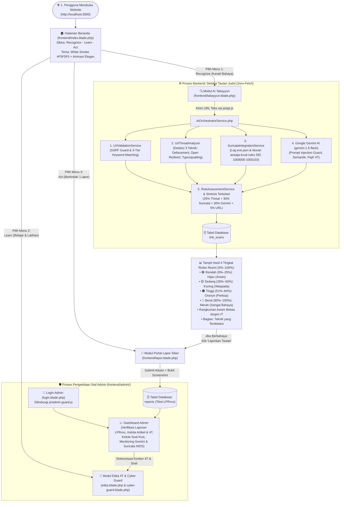

# 🔄 Sistem Kerja Web Aswaja CyberShield dari Awal hingga Akhir
## Panduan Alur Kerja Menyeluruh (End-to-End System Workflow)

Dokumen ini menjelaskan **cara kerja sistem web Aswaja CyberShield secara runtut dari awal hingga akhir**, mulai dari saat pengunjung pertama kali membuka website di browser, menggunakan fitur pemeriksaan tautan (**AI Tabayyun**), mempelajari literasi siber (**Etika 4T & Cyber Guard**), mengirim aduan (**Portal Lapor**), hingga proses pemrosesan di **Backend Laravel, Sensor Suricata NIDS, UrlThreatAnalyzer, Google Gemini AI, Database**, dan **Panel Admin**.

---

## 🗺️ 1. Diagram Besar Sistem Kerja Web (Dari Awal sampai Akhir)

---

## 🚀 2. Tahap Demi Tahap Cara Kerja Sistem dari Awal

### Tahap 1: Saat Pengguna Pertama Kali Membuka Website (`Entry Point` & *Clean URLs*)
1. Ketika pengguna mengakses alamat utama web, konfigurasi [`vercel.json`](file:///d:/cybershield/vercel.json) dan [`.htaccess`](file:///d:/cybershield/.htaccess) langsung menyajikan halaman beranda utama [`frontend/index.blade.php`](file:///d:/cybershield/frontend/index.blade.php).
2. Tampilan menggunakan palet warna **White Smoke (`#F5F5F5`)** pada latar utama dengan kartu konten putih bersih (`#FFFFFF`) dan aksen hijau emerald (`#059669`).
3. Animasi interaktif berjalan halus menggunakan `IntersectionObserver` (*fade-in* + *slide-up* bertingkat antar kartu, *floating ambient mesh* di hero, dan angka statistik yang menghitung naik secara otomatis).
4. Skrip [`js/navbar.js`](file:///d:/cybershield/js/navbar.js) menjalankan *Clean URL Engine* sehingga seluruh tautan bersih **tanpa ekstensi `.blade.php` atau `.php`**.

---

### Tahap 2: Alur Kerja Pemeriksaan Tautan di Modul AI Tabayyun (`Recognize`)
Saat pengguna memasukkan URL di [`frontend/tabayyun.blade.php`](file:///d:/cybershield/frontend/tabayyun.blade.php) dan mengklik tombol **"Mulai Analisis Tautan"**:

#### Langkah 2.1 — Pengiriman Aman Berbasis Zero-Fetch
- Browser memperlakukan URL murni sebagai **string data teks pasif**. Sistem tidak membuka atau mengunduh konten dari tautan target.
- Frontend mengirimkan permintaan `POST /api/tabayyun/analyze` ke backend Laravel.

#### Langkah 2.2 — Validasi Struktur URL & Deteksi 3 Teknik Penyusupan (`UrlThreatAnalyzer.php`)
1. **Normalisasi & SSRF Guard:** Mendekode percent-encoding berlapis (hingga 3 putaran), mendeteksi punycode IDN (`xn--`), dan memblokir alamat IP privat/internal.
2. **Web Defacement & Subdomain Hijacking:** Memeriksa domain instansi bereputasi (`.go.id`, `.ac.id`, `.sch.id`, `.mil.id`, `.desa.id`) yang disusupi kata kunci judol, direktori upload CMS (`/wp-content/uploads/`, `/uploads/`), atau subdomain dengan angka hoki judol (`88`, `138`, `777`).
3. **Open Redirect (Pembelokan URL):** Memeriksa parameter pengalihan (`url`, `redirect`, `to`, `dest`, `link`, dll.), URL bertingkat, dan pengalihan ke domain TLD murahan (`.vip`, `.top`, `.xyz`).
4. **Typosquatting & Homoglif:** Mencocokkan nama instansi resmi di [`config/threat/official_domains.php`](file:///d:/cybershield/backend/config/threat/official_domains.php) menggunakan jarak Levenshtein, substitusi karakter homoglif (`0` $\to$ `o`, `1` $\to$ `l/i`, `rn` $\to$ `m`, `vv` $\to$ `w`), dan embel-embel tipuan (`-resmi`, `-login`, `-bansos`).

#### Langkah 2.3 — Sensor Jaringan Suricata NIDS (`SuricataIntegrationService.php` & `eve.json`)
1. Membaca telemetri jaringan [`backend/storage/logs/suricata/eve.json`](file:///d:/cybershield/backend/storage/logs/suricata/eve.json) untuk mencocokkan event DNS, TLS SNI, HTTP URI, dan Alert.
2. Mencocokkan signature resmi di [`suricata.rules`](file:///d:/cybershield/suricata.rules) dan [`infra/suricata/rules/aswaja-local.rules`](file:///d:/cybershield/infra/suricata/rules/aswaja-local.rules) (SID 1000000 - 1000103).

#### Langkah 2.4 — Analisis Kognitif Google Gemini AI (`GeminiService.php`)
1. Google Gemini AI (`gemini-1.5-flash`) menerima URL sebagai data teks pasif dengan proteksi *prompt injection*.
2. Memverifikasi bukti awal dari `UrlThreatAnalyzer` dan `Suricata NIDS`, menganalisis penyamaran leetspeak, dan memetakan kepatuhan etika Fiqih Siber 4T.
3. Mengembalikan format JSON valid berisi teknik yang teridentifikasi, indikator keparahan, penalaran, dan tingkat keyakinan (*confidence*).

#### Langkah 2.5 — Sintesis Terbobot & Keputusan 2-State (`RiskAssessmentService.php`)
1. Menggabungkan bobot: $35\%$ Threat Analyzer + $30\%$ Suricata NIDS + $30\%$ Gemini AI + $5\%$ Struktur URL.
2. Menghasilkan vonis 2 keadaan:
   - **Aman:** Menampilkan **"Tingkat Keamanan"** ($0\% - 100\%$, hijau emerald).
   - **Berbahaya:** Menampilkan **"Tingkat Bahaya"** ($0\% - 100\%$, merah danger). Label "Sangat Berbahaya" disematkan jika skor bahaya $\ge 85\%$.

#### Langkah 2.6 — Penampilan Hasil & Interaksi Pengguna
1. Kartu hasil menampilkan persentase skor, alasan verifikasi, dan bagian khusus **"Teknik yang Terdeteksi"** jika ditemukan indikasi penyusupan judol.
2. Tautan ditampilkan secara aman dalam bentuk teks monospace non-aktif (tidak dapat diklik).
3. Tombol **"Salin Ringkasan Verifikasi"** menyalin bukti lengkap termasuk teknik terdeteksi ke clipboard.
4. Tombol **"Laporkan Tautan Ini"** mengarahkan pengguna langsung ke formulir aduan di `/lapor?url=...`.

---

### Tahap 3: Alur Kerja Modul Edukasi 4T & Simulasi Cyber Guard (`Learn`)

1. **Modul Etika & Fiqih Siber (`/etika` & `/artikel/:slug`):**
   - Mengambil data dinamis Kaidah 4T (*Tawaqquf, Tastabbus, Tatsabbut, Ta'aqqul*) dari backend yang dapat dikelola admin secara live.
   - Menyajikan 6 artikel kajian fiqih digital (Adab Medsos, Bahaya Ghibah Digital, Privasi Data, Mitigasi APK Phishing, Menghadapi Deepfake, dan Muamalah Finansial).
   - Seluruh halaman bacaan materi dirancang terpadu dengan eliminasi celah kosong di atas footer (`mt-0`) serta gambar sampul yang dimuat seketika tanpa risiko galat.
2. **Cyber Guard Interactive Test (`/cyber-guard`):**
   - Menghadirkan simulasi kasus rekayasa sosial nyata.
   - Evaluasi jawaban langsung menampilkan pembahasan kaidah fiqih digital dan skor ketahanan literasi pengguna.

---

### Tahap 4: Alur Kerja Pengaduan Masyarakat di Portal Lapor (`Act`)

1. Pengguna membuka [`frontend/lapor.blade.php`](file:///d:/cybershield/frontend/lapor.blade.php).
2. Memilih kategori insiden, kronologi, opsi pelapor anonim (*Hamba Allah*), dan mengunggah tangkapan layar.
3. **Proteksi Kuota (Rate Limiting 2x per 2 Jam):** Sistem menerapkan pembatasan frekuensi pengiriman laporan. Jika pelapor mengirimkan lebih dari 2 kali dalam 2 jam, sistem menampilkan pop-up peringatan edukatif dengan 4 alasan keamanan dan tombol kirim otomatis dinonaktifkan.
4. Backend memproses aduan dan menerbitkan nomor tiket unik (contoh: **`LPR082`**) yang tercatat pada rekapitulasi pelaporan publik.

---

### Tahap 5: Alur Kerja Panel Admin (`/admin`)

1. **Login Staf Admin (`/login`):**
   - Dilengkapi proteksi sesi [`js/admin-guard.js`](file:///d:/cybershield/js/admin-guard.js) dan indikator verifikasi terpusat (*centered spinner*).
   - Akun staf administrator langsung aktif tanpa memerlukan tahapan verifikasi email (*no email verification required*).
2. **Arsitektur Sidebar Modern:**
   - Navigasi sidebar terfokus dan terstruktur rapi dengan wadah profil pengguna (*Admin Utama / Super Admin*) yang menempel di bagian paling bawah sidebar (`mt-auto shrink-0`).
   - Dialog modal konfirmasi logout yang modern dan aman.
3. **Manajemen Laporan (`/admin/laporan`):** Memverifikasi aduan masyarakat, mengubah status tiket (`Pending` $\to$ `Diproses` $\to$ `Selesai`), dan mencatat hasil analisis forensik.
4. **Manajemen Konten & Kaidah 4T (`/admin/artikel`):** CRUD artikel literasi siber dan editor kaidah 4T interaktif (`#modal-4t`) dengan *optimistic UI rendering* dan sinkronisasi live ke Supabase PostgreSQL.
5. **Manajemen Akun (`/admin/akun`):** Pengelolaan staf admin dengan pembagian wewenang peran RBAC (*Super Admin* vs *Admin Basic*).
