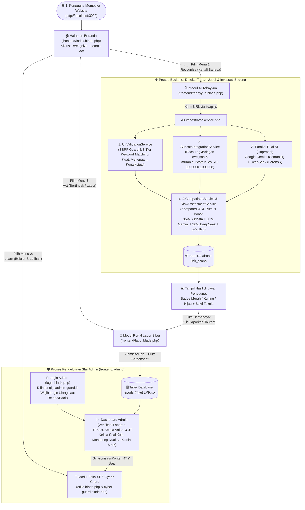

# 🔄 Sistem Kerja Web Aswaja CyberShield dari Awal hingga Akhir
## Panduan Alur Kerja Menyeluruh (End-to-End System Workflow)

Dokumen ini menjelaskan **cara kerja sistem web Aswaja CyberShield secara runtut dari awal hingga akhir**, mulai dari saat pengunjung pertama kali membuka website di browser, menggunakan fitur pemeriksaan tautan (**AI Tabayyun**), mempelajari literasi siber (**Etika 4T & Cyber Guard**), mengirim aduan (**Portal Lapor**), hingga proses pemrosesan di **Backend Laravel, Sensor Suricata, Dual AI, Database**, dan **Panel Admin**.

---

## 🗺️ 1. Diagram Besar Sistem Kerja Web (Dari Awal sampai Akhir)

---

## 🚀 2. Tahap Demi Tahap Cara Kerja Sistem dari Awal

### Tahap 1: Saat Pengguna Pertama Kali Membuka Website (`Entry Point` & *Clean URLs*)
1. Ketika pengguna mengakses alamat utama web (baik di `https://aswajacybershield.vercel.app/` maupun di server lokal), konfigurasi [`vercel.json`](file:///d:/aswajaCyber/vercel.json), [`.htaccess`](file:///d:/aswajaCyber/.htaccess), dan [`index.php`](file:///d:/aswajaCyber/index.php) langsung menyajikan halaman beranda utama [`frontend/index.blade.php`](file:///d:/aswajaCyber/frontend/index.blade.php).
2. Skrip [`js/navbar.js`](file:///d:/aswajaCyber/js/navbar.js) secara otomatis menjalankan *Clean URL Engine* (`window.history.replaceState` dan `MutationObserver`) sehingga seluruh alamat halaman tampil bersih **tanpa ekstensi `.blade.php` atau `.php`** (seperti `/`, `/tabayyun`, `/etika`, `/cyber-guard`, `/lapor`, `/artikel/:slug`, `/login`, dan `/admin`).
3. Di halaman beranda, pengguna diperkenalkan dengan **3 Pilar Utama (Recognize – Learn – Act)**:
   - **Recognize (Kenali):** Memeriksa tautan mencurigakan di **AI Tabayyun** (`/tabayyun`).
   - **Learn (Pelajari):** Memahami kaidah **Etika Fiqih Siber 4T** (`/etika`) dan menguji refleks di **Cyber Guard Test** (`/cyber-guard`).
   - **Act (Bertindak):** Melaporkan tautan judi online atau investasi bodong di **Portal Lapor Siber** (`/lapor`).

---

### Tahap 2: Alur Kerja Pemeriksaan Tautan di Modul AI Tabayyun (`Recognize`)
Saat pengguna membuka [`frontend/tabayyun.blade.php`](file:///d:/aswajaCyber/frontend/tabayyun.blade.php) dan memasukkan sebuah URL (misalnya tautan yang diterima dari grup WhatsApp/Telegram) lalu menekan tombol **"Mulai Analisis Tautan"**:

#### Langkah 2.1 — Pengiriman Aman dari Frontend (`js/tabayyun.js` & `js/api.js`)
- Skrip [`js/tabayyun.js`](file:///d:/aswajaCyber/js/tabayyun.js) menangkap URL tersebut sebagai **teks tidak tepercaya (*untrusted input*)** — browser tidak pernah membuka atau mengeksekusi isi halaman URL tersebut.
- Fungsi `ApiService.analyzeUrl(url)` di [`js/api.js`](file:///d:/aswajaCyber/js/api.js) mengirim permintaan `POST /api/tabayyun/analyze` ke server Backend Laravel.

#### Langkah 2.2 — Validasi Struktur URL & Pencocokan 3 Tingkat (`UrlValidationService.php`)
Backend menerima URL di [`AiOrchestratorService.php`](file:///d:/aswajaCyber/backend/app/Services/AiOrchestratorService.php) dan meneruskannya ke [`UrlValidationService.php`](file:///d:/aswajaCyber/backend/app/Services/UrlValidationService.php):
1. **Normalisasi & SSRF Guard:** Menambahkan protokol `https://` jika belum ada, mengekstrak nama host/domain, dan memblokir alamat IP lokal/internal (`127.0.0.1`, `192.168.x.x`) demi keamanan server.
2. **Deteksi Anomali Teknis Domain:** Memeriksa apakah domain mencatut nama lembaga resmi (*typosquatting* seperti `ojk-investasi.xyz`), memakai alamat IP langsung (`http://185.220.101.5/slot`), menggunakan TLD murahan yang sering dipakai sindikat (`.top`, `.vip`, `.xyz`, `.cc`), menggunakan huruf berulang (`investasii2026.com`), atau angka acak panjang.
3. **Pencocokan Kata Kunci 3 Tingkat (*3-Tier Keyword Matching*):**
   - **Tingkat Kuat (`strong`):** Kata kunci eksplisit judi online (`slot gacor`, `situs togel`, `casino online`). Jika ditemukan, langsung menjadi indikator kuat.
   - **Tingkat Menengah (`medium`):** Istilah fitur taruhan (`maxwin`, `jackpot`, `scatter`, `free spin`). Membutuhkan indikator pendukung (seperti angka `777`, TLD `.xyz`, atau path `/deposit`) untuk divonis sebagai judi online; jika berdiri sendiri hanya diberi status peringatan (`mencurigakan`).
   - **Tingkat Kontekstual (`contextual`):** Kata umum/mitologi (`zeus`, `dewa`, `thor`, `dragon`). Membutuhkan pemeriksaan tambahan agar website edukasi/sejarah biasa **tidak salah dideteksi** sebagai situs judi online.

#### Langkah 2.3 — Inspeksi Lalu Lintas Jaringan Suricata NIDS (`SuricataIntegrationService.php` & `eve.json`)
Selanjutnya sistem memeriksa sensor jaringan melalui [`SuricataIntegrationService.php`](file:///d:/aswajaCyber/backend/app/Services/SuricataIntegrationService.php) dan [`SuricataService.php`](file:///d:/aswajaCyber/backend/app/Services/SuricataService.php):
1. Membaca berkas log telemetri jaringan [`backend/storage/logs/suricata/eve.json`](file:///d:/aswajaCyber/backend/storage/logs/suricata/eve.json) untuk mencari rekaman paket `dns`, `tls` (SNI handshake), `http`, dan `alert` yang berkaitan dengan domain target.
2. Mencocokkan URL dengan 9 aturan signature resmi di [`suricata.rules`](file:///d:/aswajaCyber/suricata.rules) (`SID: 1000000` untuk Whitelist Regulator Resmi OJK/Bappebti, hingga `SID: 1000001`–`1000008` untuk aturan Judol dan Investasi Bodong).

#### Langkah 2.4 — Analisis Kognitif Paralel Dual AI (`GeminiService.php` & `DeepSeekService.php`)
Secara serentak (*non-blocking parallel request* menggunakan `Http::pool()`), sistem mengirim URL beserta metadata awalnya ke **dua model AI sekaligus**:
1. **Google Gemini (`GeminiService.php`):** Menganalisis konteks bahasa penawaran, klaim keuntungan palsu, penyamaran kata (*leetspeak*), dan relevansinya dengan kaidah Fiqih 4T.
2. **DeepSeek AI (`DeepSeekService.php`):** Melakukan audit forensik independen terhadap pola rekening penampung, jebakan deposit/withdraw, serta skema Ponzi/piramida.

#### Langkah 2.5 — Komparasi AI & Perhitungan Rumus Skor Risiko (`AiComparisonService.php` & `RiskAssessmentService.php`)
1. [`AiComparisonService.php`](file:///d:/aswajaCyber/backend/app/Services/AiComparisonService.php) membandingkan apakah Gemini dan DeepSeek menghasilkan kesimpulan kategori yang sama (`isMatch`) atau berbeda pendapat (`hasDiscrepancy`), serta menggabungkan bukti temuan keduanya tanpa duplikasi.
2. [`RiskAssessmentService.php`](file:///d:/aswajaCyber/backend/app/Services/RiskAssessmentService.php) menghitung skor risiko gabungan dengan rumus:
   $$\text{RiskScore} = \text{round}\Big((0.35 \times S_{\text{Suricata}}) + (0.30 \times S_{\text{Gemini}}) + (0.30 \times S_{\text{DeepSeek}}) + (0.05 \times S_{\text{URL}})\Big)$$
   Lalu mengonversinya menjadi **Skor Keamanan Tampilan** ($\text{SafetyScore} = 100 - \text{RiskScore}$, dibatasi pada rentang $5\%$ hingga $98\%$).

#### Langkah 2.6 — Pencatatan Database & Penampilan Hasil di Layar (Light Mode & Dark Mode)
1. [`ScanHistoryService.php`](file:///d:/aswajaCyber/backend/app/Services/ScanHistoryService.php) menyimpan hasil pemeriksaan ke tabel `link_scans` (dengan nomor ID unik `SCN-YYYYMMDD-XXXXXX`), di mana hasil Suricata, Gemini, dan DeepSeek disimpan pada kolom JSONB terpisah.
2. Frontend [`js/tabayyun.js`](file:///d:/aswajaCyber/js/tabayyun.js) menerima respons JSON dan menyetel atribut `data-alert` pada kartu hasil (`#tabayyun-result-card`) agar skema warna latar, border, badge, skor, dan sub-kotak menyesuaikan hasil analisis secara dinamis baik di **Light Mode** maupun **Dark Mode** (`data-alert="red"` untuk *Terindikasi Judol/Investasi Menyesatkan*, `data-alert="amber"` untuk *Mencurigakan*, dan `data-alert="emerald"` untuk *Aman/Normal*), lengkap dengan daftar bukti temuan, perbandingan Dual AI, serta tombol **"Salin Ringkasan"** dan **"Laporkan Tautan"** (`/lapor?url=...`).

---

### Tahap 3: Alur Kerja Modul Edukasi 4T & Simulasi Cyber Guard (`Learn`)

#### A. Modul Etika & Fiqih Siber (`frontend/etika.blade.php`)
1. Saat pengguna membuka halaman **Etika Siber**, skrip [`js/etika.js`](file:///d:/aswajaCyber/js/etika.js) mengambil data terbaru **Prinsip 4T** (*Tawaqquf, Tastabbus, Tatsabbut, Ta'aqqul*) dari API `/api/prinsip-4t`.
2. Pengguna dapat memfilter 6 modul bacaan fiqih digital (Adab Medsos, Bahaya Ghibah Digital, Fiqih Privasi Data, Mitigasi APK Phishing, Menghadapi Deepfake, dan Muamalah Finansial) atau membuka halaman artikel lengkap di [`frontend/artikel/`](file:///d:/aswajaCyber/frontend/artikel).

#### B. Modul Simulasi Refleks Cyber Guard (`frontend/cyber-guard.blade.php`)
1. Pengguna disajikan 5 skenario studi kasus interaktif menyerupai tampilan chat WhatsApp/Telegram nyata (seperti tawaran robot trading, promosi slot gacor, dan file `.apk` undangan/kurir).
2. Saat pengguna memilih salah satu opsi tindakan (A, B, C, atau D), skrip [`js/cyber-guard.js`](file:///d:/aswajaCyber/js/cyber-guard.js) langsung mengevaluasi jawaban, menampilkan pembahasan teknis & fiqih di tempat, dan menghitung skor akhir ketahanan digital pengguna (`0`–`100`).

---

### Tahap 4: Alur Kerja Pengaduan Masyarakat di Portal Lapor (`Act`)
1. Pengguna membuka [`frontend/lapor.blade.php`](file:///d:/aswajaCyber/frontend/lapor.blade.php) (jika diklik dari tombol *"Laporkan Tautan"* di AI Tabayyun, kolom URL otomatis terisi).
2. Pengguna memilih kategori pelanggaran, menuliskan kronologi singkat, memilih opsi pelapor anonim (*Hamba Allah*), dan mengunggah bukti tangkapan layar.
3. Saat tombol **"Kirim Laporan Sekarang"** ditekan, [`js/lapor.js`](file:///d:/aswajaCyber/js/lapor.js) mengirim data ke `POST /api/reports`.
4. Backend menyimpan laporan, menerbitkan nomor tiket unik 3 digit (contoh: **`LPR082`**), dan menampilkannya pada tabel rekapitulasi publik secara transparan.

---

### Tahap 5: Alur Kerja Panel Admin & Keamanan Sesi (`/login` & `/admin`)
1. **Login Staf Admin (`/login` — [`frontend/admin/login.blade.php`](file:///d:/aswajaCyber/frontend/admin/login.blade.php)):**
   - Diakses langsung melalui URL bersih **`/login`** (contoh: `https://aswajacybershield.vercel.app/login`).
   - Staf masuk menggunakan akun **Super Admin** (`admin` / `Aswaja2026!`) atau **Admin Basic** (`analis` / `Aswaja2026!`).
   - Formulir login tidak menyimpan riwayat input (`autocomplete="off"`) dan setelah berhasil login langsung mengarahkan ke **`/admin`**.
2. **Proteksi Sesi Ketat ([`js/admin-guard.js`](file:///d:/aswajaCyber/js/admin-guard.js)):**
   - Selama berada di dalam halaman admin, jika staf melakukan **Reload / Refresh** halaman atau keluar lalu menekan tombol panah **Back / Forward** di browser, `admin-guard.js` otomatis menghapus sesi login dan mewajibkan staf login ulang di `/login`.
3. **Operasional Pengelolaan Admin (Dengan Clean URLs):**
   - **Menu Dashboard (`/admin`):** Memantau metrik KPI laporan masuk, diproses, dan selesai.
   - **Menu Laporan (`/admin/laporan`):** Memeriksa bukti aduan warga, mengubah status tiket (`Masuk` → `Diproses` → `Selesai`), dan mencatat hasil verifikasi.
   - **Menu Artikel (`/admin/artikel`):** Menambah/mengedit artikel edukasi dan memperbarui teks **Kaidah 4T** yang langsung berubah di halaman publik.
   - **Menu Studi Kasus (`/admin/studi-kasus`):** Mengelola soal dan pembahasan kuis Cyber Guard.
   - **Menu Integrasi Dual AI (`/admin/integrasi-ai`):** Memantau kesehatan koneksi Google Gemini, DeepSeek AI, dan Suricata NIDS.
   - **Menu Kelola Akun (`/admin/akun` — Khusus Super Admin):** Mengatur akun staf dan pembagian hak akses.

